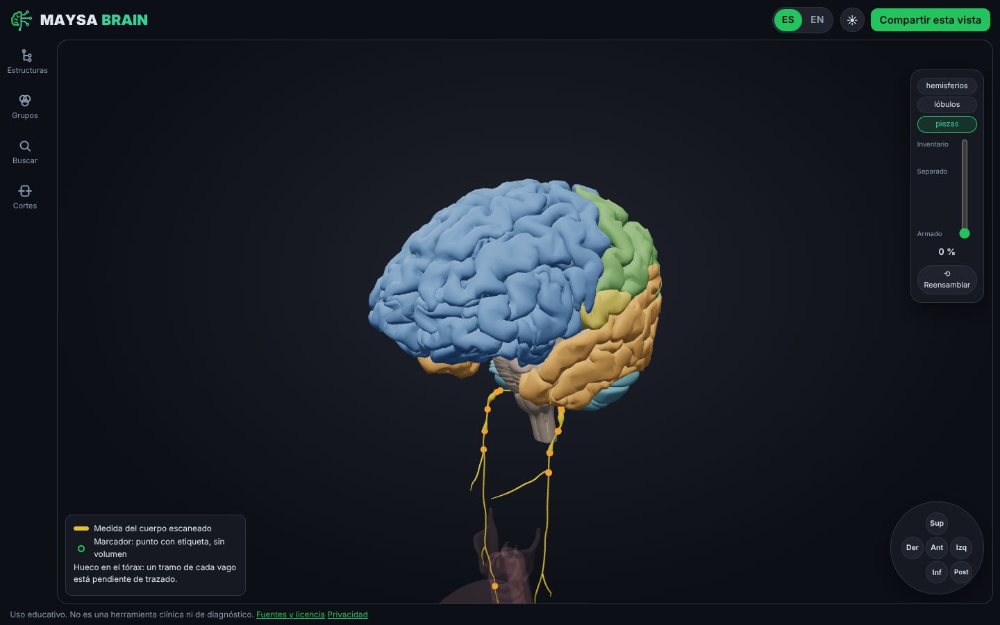
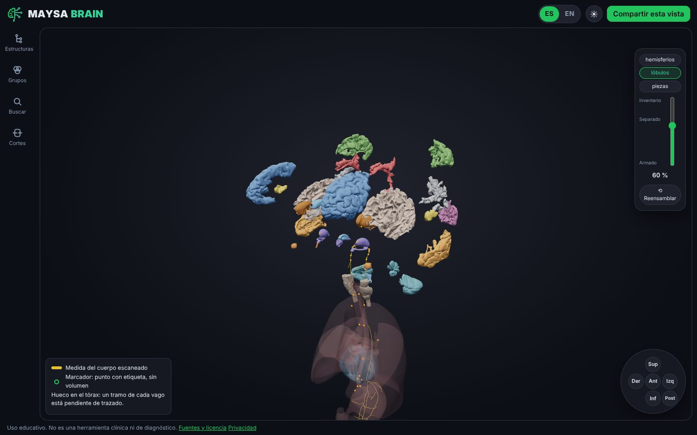
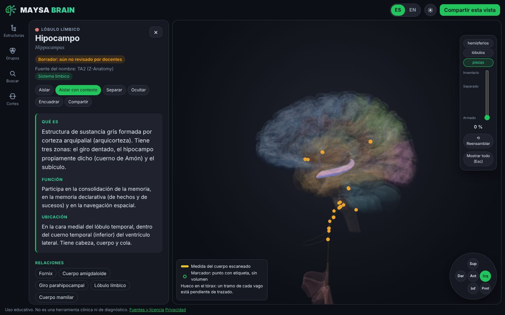
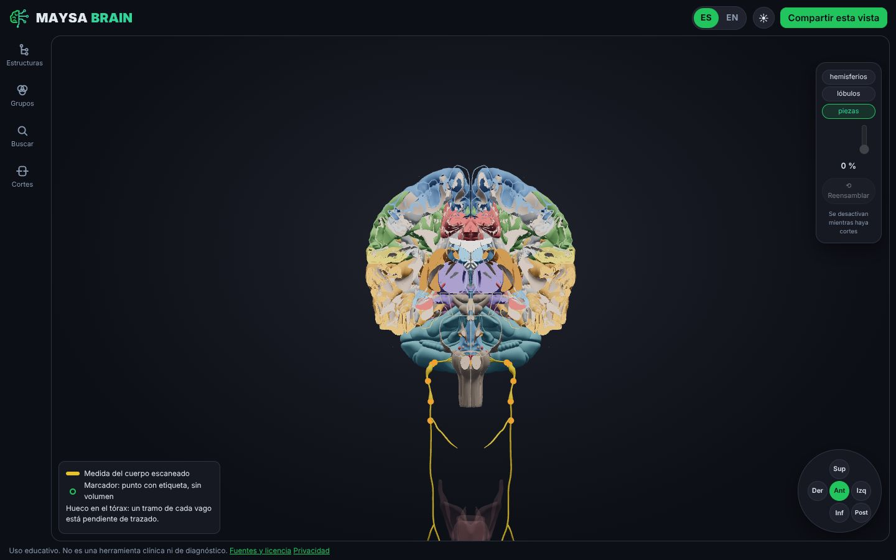
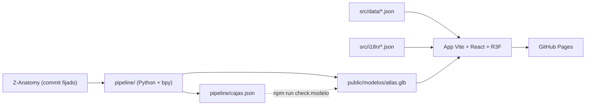

[English](README.md) · **Español**

<p align="center">
  <picture>
    <source media="(prefers-color-scheme: dark)" srcset="public/marca/maysa-brain-oscuro.svg">
    
  </picture>
</p>

# 🧠 Maysa Brain

**Un atlas 3D, gratuito y bilingüe del cerebro y el nervio vago. Desármalo, estudia cada pieza y vuelve a armarlo en su lugar exacto.**

[](https://brain.maysasp.com/)
[](LICENSE)
[](LICENSE-CONTENT)
[](https://github.com/ragarciaga/3d_brain/actions/workflows/rockbuilt-ci.yml)
[](https://github.com/ragarciaga/3d_brain/actions/workflows/pages.yml)

**Uso educativo. No es una herramienta clínica ni de diagnóstico.**

**📑 Contenido:** [Qué es](#-qué-es) · [Por qué](#-por-qué-este-atlas) · [Estado](#-estado) · [Funciones](#-funciones) · [Hoja de ruta](#-hoja-de-ruta) · [Capturas](#-capturas) · [Cómo está hecho](#-cómo-está-hecho) · [IA y revisión humana](#-hecho-con-herramientas-de-ia-y-revisión-humana) · [Calidad del contenido](#-calidad-del-contenido) · [Cómo aportar](#-cómo-aportar) · [Replícalo](#-replícalo) · [Privacidad](#-privacidad) · [Licencia](#-licencia-y-créditos) · [Autores](#-autores) · [Documentos](#-documentos-del-proyecto)

## 🎯 Qué es

Maysa Brain es un atlas web público para estudiantes de psicología y ciencias de la salud. Es gratuito, no pide cuenta y funciona en español y en inglés. Entra a **https://brain.maysasp.com/**, elige una estructura y lee su ficha, separa el cerebro en piezas, córtalo con un plano o sigue el nervio vago desde el tronco encefálico hasta el abdomen.

También sirve a docentes que quieren mostrar una estructura en clase y a docentes que revisan el contenido ficha por ficha.

## 💡 Por qué este atlas

Cuatro ideas deciden cada función. Si una función no refuerza alguna, no entra.

1. **Circuitos para psicología.** En psicología se estudian sistemas (memoria, miedo, recompensa), no nombres sueltos. Hacia allá va el producto. Hoy el único recorrido guiado es el del nervio vago; los circuitos están en la [hoja de ruta](#-hoja-de-ruta).
2. **Cerebro y vago en el mismo espacio.** Comparten coordenadas, así que ves por dónde sale el nervio del cráneo y cómo se relaciona con las estructuras que lo rodean.
3. **Bilingüe de verdad.** La búsqueda cruza español, inglés y latín: "amígdala", "amygdala" y "corpus amygdaloideum" llegan a la misma ficha. Cada ficha muestra el nombre en latín.
4. **Fuentes y revisión docente.** Cada ficha cita sus fuentes, indica qué tan sólida es la evidencia y muestra si un docente la revisó. Nada anatómico se inventa.

## 📍 Estado

- **Hito 1, piloto con docentes.** Las 236 fichas están escritas con fuentes verificadas. Siguen marcadas como borrador hasta que las revisen docentes.
- **Hito 2, en curso.** Los planos de corte (F8) y "Reportar un error" (F12) ya están publicados. La meta es tener 40 fichas verificadas en los dos idiomas.
- **Vago torácico: un hueco explicado.** El modelo escaneado trae un tramo torácico en espejo, así que el atlas no lo publica y lo dice en pantalla. Sigue así hasta que se trace una ruta corregida y un docente la revise; el trazado está pendiente y diferido (plan B, [ADR 0010](docs/adr/0010-vago-toracico-trazado.md)).

## ✨ Funciones

Solo lo que ya existe en `main`.

| Área | Qué puedes hacer |
|---|---|
| Modo estudio | El cerebro a pantalla completa y un riel lateral que abre el árbol de estructuras, los grupos de estudio, los planos de corte y la búsqueda solo cuando los pides. |
| Búsqueda | `Ctrl+K` encuentra estructuras en español, inglés, latín y sinónimos, con tolerancia a tildes y errores. |
| Ficha | Qué es, función, ubicación, relaciones, relevancia en psicología con nivel de evidencia, recursos, búsquedas de artículos y fuentes. |
| Desarmar | Fragmenta por hemisferios, lóbulos o piezas con un deslizador vertical, manda piezas al inventario, usa **Separar** en una y **Reensamblar** devuelve todo a su posición exacta. Una brújula orienta las vistas. |
| Planos de corte | Sagital, coronal y axial, con el aviso de que el modelo es un solo cuerpo. |
| Nervio vago | No se fragmenta. **Recorrer el vago** lo sigue en 4 paradas y lo va dibujando. |
| Origen de la geometría | Una leyenda distingue la geometría medida (del cuerpo escaneado) de los marcadores (un punto con etiqueta, sin volumen) y avisa del hueco explicado en el tórax. Las rutas trazadas, cuando lleguen, se verán mate y punteadas, con el filtro **Solo geometría escaneada** ([ADR 0010](docs/adr/0010-vago-toracico-trazado.md), [docs/v2.md](docs/v2.md)). |
| Compartir | Un enlace por estructura e idioma (`/es/hipocampo`, `/en/hippocampus`) y **Compartir esta vista**. |
| Comodidad | Tema claro y oscuro. |
| Reportar un error | Desde cualquier ficha, con un formulario de GitHub o por correo. |
| Revisión docente | Un enlace personal convierte el atlas en una herramienta de revisión campo por campo. |
| Transparencia | Páginas de privacidad y de licencia, y `?medir=1` para medir la carga en tu equipo. |

## 🧭 Hoja de ruta

Todavía no está disponible. El alcance y el orden están en [SPEC.md](SPEC.md) y [docs/v2.md](docs/v2.md).

- **F13** notas y recursos personales, guardados solo en tu navegador.
- **F14** circuitos guiados para psicología, empezando por Papez (el recorrido del vago ya existe).
- **F15** quiz con repaso espaciado. **F16** modo rompecabezas.
- **F17** casos clásicos (H.M., Phineas Gage, Broca, Wernicke).
- **F18** etiquetas 3D. **F19** modelo liviano para celulares de gama baja. **F20** indexación en buscadores.
- **F21** colecciones para docentes. **F22** uso sin internet. **F23** exportar una imagen para apuntes.

## 📸 Capturas

<table>
  <tr>
    <td width="50%"><br><sub>Modo estudio</sub></td>
    <td width="50%"><br><sub>Desarmado por lóbulos</sub></td>
  </tr>
  <tr>
    <td width="50%"><br><sub>Ficha de una estructura</sub></td>
    <td width="50%"><br><sub>Planos de corte</sub></td>
  </tr>
</table>

## 🧱 Cómo está hecho

**Tecnología:** TypeScript estricto, Vite, React, three.js con react-three-fiber y drei, zustand, react-router, i18next, fuse.js, idb-keyval, Vitest y Playwright. El pipeline del modelo usa Python con `bpy` de Blender y glTF-Transform. El alojamiento es GitHub Pages, sin backend. Las versiones exactas están en [AGENTS.md](AGENTS.md).



Tres reglas le dan forma al código:

- **Una pieza nunca se mueve en el mundo.** El único cambio es el giro global de Z arriba a Y arriba del exportador glTF. Desarmar es un desplazamiento en el estado de zustand que se suma a la posición original, y reensamblar lo vuelve a cero. `npm run check:modelo` falla si la caja de alguna malla se corre más de 0,1 mm respecto de `pipeline/cajas.json`.
- **Geometría y contenido van separados.** El GLB solo trae mallas y todo el texto vive en `src/data/*.json`. La llave entre los dos es el nombre de la malla en `pipeline/mapeo.csv`, así que corregir contenido nunca exige regenerar el GLB.
- **Sin backend y sin IA en el producto.** La app es un flujo fijo: no hay chatbot ni nada que interprete texto libre mientras se usa ([ADR 0002](docs/adr/0002-sin-ia-flujo-fijo.md)).

## 🤖 Hecho con herramientas de IA y revisión humana

Este repositorio se construye con herramientas de IA para programar, orquestadas por el harness abierto [Rockbuilt](https://github.com/ragarciaga/rockbuilt), que divide cada cambio en plan, implementación, verificación y auditoría.

La anatomía siempre la decide una persona. Un cambio en `src/data/**`, `pipeline/mapeo.csv`, `pipeline/cajas.json` o `public/modelos/**` espera la aprobación del editor, y los docentes validan nombres, fichas y posiciones de marcadores. Toda ruta trazada del nervio necesita revisión docente antes de mostrarse como revisada. Una revisión docente nunca se aplica sola: se convierte en un cambio propuesto que el editor aprueba.

## 🔬 Calidad del contenido

- Cada registro lleva su fuente, y los nombres salen de Terminologia Anatomica 2 cuando existen.
- Cada afirmación tiene un nivel de evidencia: consenso, moderada o debatida.
- Cuando falta la fuente o la certeza, el campo dice `PENDIENTE`. Nunca se inventa.
- Cada ficha está en **borrador**, **en revisión** o **verificada**, y una ficha revisada dice "Revisado por un docente universitario", sin nombres.
- Los recursos externos (StatPearls, Kenhub y otros) se enlazan, nunca se copian.

## 🤝 Cómo aportar

- **¿Viste un error?** Pulsa **Reportar un error** en la ficha. Ofrece los cuatro formularios de GitHub o un correo.
- **¿Eres docente?** Escribe a info@maysasp.com. El editor te entrega un enlace personal de revisión.
- **Código:** lee [CONTRIBUTING.md](CONTRIBUTING.md) (en inglés) para la rama, las verificaciones y las reglas.
- **Traducciones:** la interfaz vive en `src/i18n/es.json` y `src/i18n/en.json`.

## 🔁 Replícalo

**Córrelo en local.** Node.js 22.18 o superior (se recomienda 24 LTS):

```bash
npm ci
npm run dev
```

Abre http://localhost:3000.

**Verifica todo:**

```bash
npm run typecheck
npm run lint
npm test
npm run check:i18n
npm run check:modelo
npm run build
npm run test:e2e
```

- **Regenerar el modelo:** sigue [pipeline/README.md](pipeline/README.md). El GLB nunca se edita a mano.
- **Publicar en GitHub Pages:** [.github/workflows/pages.yml](.github/workflows/pages.yml) despliega cada fusión a `main`. Una sola vez, en Settings > Pages > Source elige GitHub Actions. El build sirve desde la raíz del sitio (`base: '/'` en `vite.config.ts`), así que usa un dominio propio (Settings > Pages; no hay archivo `CNAME`, ver [ADR 0014](docs/adr/0014-dominio-propio.md)) o cambia `base` a `'/<repo>/'` si lo publicas como sitio de proyecto en `<usuario>.github.io/<repo>/`.
- **Adaptarlo a otra región:** cambia `pipeline/` y `pipeline/mapeo.csv`, y escribe el contenido en `src/data/*.json`. Otro idioma pide código: el tipo `Idioma` en `src/data/tipos.ts`, las rutas en `src/main.tsx` y un nuevo `src/i18n/<código>.json`.
- Los derivados conservan CC BY-SA 4.0 y los créditos de abajo.

## 🔒 Privacidad

- Sin cuentas, sin cookies y sin datos personales en ningún servidor de este proyecto.
- Las visitas se cuentan con Cloudflare Web Analytics, que no usa cookies. No se carga en el modo revisión ni con `npm run dev`.
- El sitio está alojado en GitHub Pages.
- La revisión docente es la única excepción: las respuestas van a la hoja de Google del editor mediante un Apps Script de su cuenta, con una autorización explícita dentro de la app (Ley 1581 de 2012).

Lee la [página de privacidad](https://brain.maysasp.com/es/privacidad), el [ADR 0015](docs/adr/0015-analitica-sin-cookies.md) y el [ADR 0012](docs/adr/0012-apps-script-canal-revision.md).

## 📜 Licencia y créditos

- Modelo 3D: obra derivada de [Z-Anatomy](https://github.com/Z-Anatomy/Models-of-human-anatomy) (CC BY-SA 4.0), construido sobre BodyParts3D, © The Database Center for Life Science (CC BY-SA 2.1 Japón). Nombres: Terminologia Anatomica 2, incluida en Z-Anatomy.
- Modelo y contenido de este atlas: CC BY-SA 4.0 ([LICENSE-CONTENT](LICENSE-CONTENT)).
- Código: MIT ([LICENSE](LICENSE)).

## 👤 Autores

- **Rafael Andrés García, Consultor IA** · [LinkedIn](https://www.linkedin.com/in/ragarciaga/) · [maysasp.com](https://maysasp.com) · info@maysasp.com
- **Lorena Gómez, Psicóloga en formación** · [LinkedIn](https://www.linkedin.com/in/loregomeza/)

## 📚 Documentos del proyecto

- [SPEC.md](SPEC.md): alcance y funciones (F1 a F25). [AGENTS.md](AGENTS.md): reglas del proyecto.
- [docs/brief.md](docs/brief.md) y [docs/adr/](docs/adr/): producto y decisiones.
- [docs/enlaces.md](docs/enlaces.md): todos los enlaces del proyecto. [docs/progress.md](docs/progress.md): estado actual.
- [docs/operacion.md](docs/operacion.md): guía del editor. [docs/revision-docente.md](docs/revision-docente.md) y [docs/guia-docentes.md](docs/guia-docentes.md): revisión docente.
- [pipeline/README.md](pipeline/README.md): cómo se genera el modelo. [docs/research/fase-0/REPORT.md](docs/research/fase-0/REPORT.md): qué trae y qué no trae el modelo.
