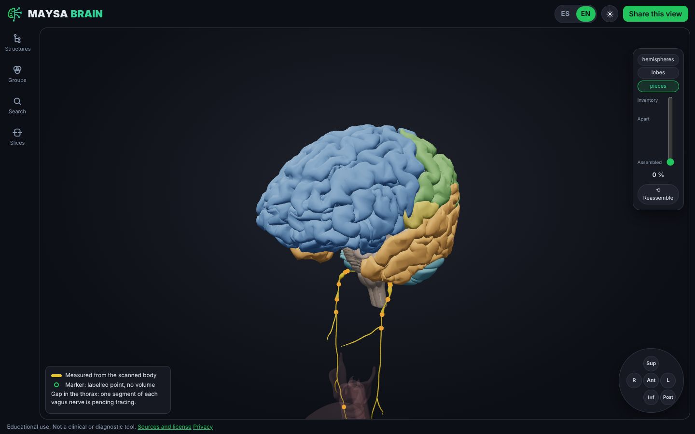
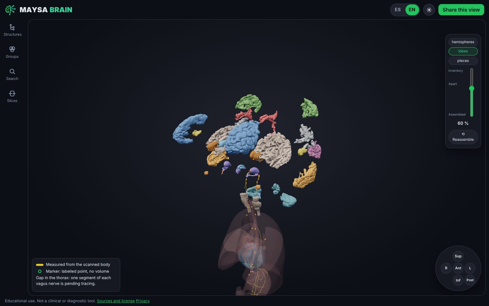
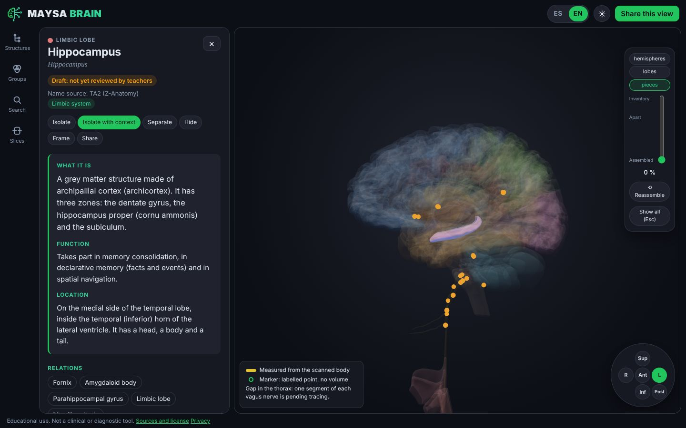
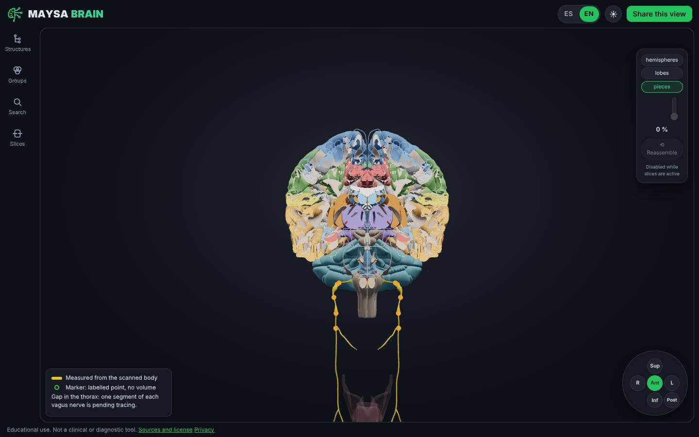
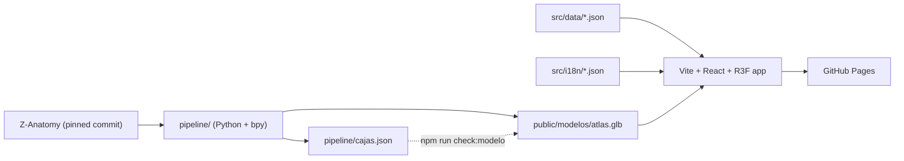

**English** · [Español](README.es.md)

<p align="center">
  <picture>
    <source media="(prefers-color-scheme: dark)" srcset="public/marca/maysa-brain-oscuro.svg">
    
  </picture>
</p>

# 🧠 Maysa Brain

**A free, bilingual 3D atlas of the brain and the vagus nerve. Take it apart, study each piece, put it back exactly where it was.**

[](https://brain.maysasp.com/)
[](LICENSE)
[](LICENSE-CONTENT)
[](https://github.com/ragarciaga/3d_brain/actions/workflows/rockbuilt-ci.yml)
[](https://github.com/ragarciaga/3d_brain/actions/workflows/pages.yml)

**Educational use. Not a clinical or diagnostic tool.**

**📑 Contents:** [What it is](#-what-it-is) · [Why](#-why-this-atlas) · [Status](#-status) · [Features](#-features) · [Roadmap](#-roadmap) · [Screenshots](#-screenshots) · [How it's built](#-how-its-built) · [AI and human review](#-built-with-ai-tools-and-human-review) · [Content quality](#-content-quality) · [Contributing](#-contributing) · [Replicate it](#-replicate-it) · [Privacy](#-privacy) · [License](#-license-and-credits) · [Author](#-author) · [Documents](#-project-documents)

## 🎯 What it is

Maysa Brain is a public web atlas for psychology and health-science students. It is free, has no accounts, and works in Spanish and English. Open **https://brain.maysasp.com/**, pick a structure and read its card, split the brain into pieces, cut it with a plane, or follow the vagus nerve from the brainstem down to the abdomen.

It is also meant for teachers who want to show a structure in class, and for teachers who review the content one card at a time.

## 💡 Why this atlas

Four ideas decide every feature. If a feature does not strengthen one of them, it does not go in.

1. **Circuits for psychology.** Psychology students study systems (memory, fear, reward), not isolated names. That is the direction of the product. Today the only guided route is the vagus nerve; the circuits are on the [roadmap](#-roadmap).
2. **Brain and vagus nerve in one space.** They sit in the same coordinates, so you can see where the nerve leaves the skull and how it relates to the structures around it.
3. **Really bilingual.** Search works across Spanish, English and Latin, so "amygdala", "amígdala" and "corpus amygdaloideum" reach the same card. Every card shows the Latin name.
4. **Sources and teacher review.** Every card cites its sources, labels how strong the evidence is, and shows whether a teacher has reviewed it. Nothing anatomical is invented.

## 📍 Status

- **Milestone 1, pilot with teachers.** All 236 cards are written with verified sources. They stay marked as drafts until teachers review them.
- **Milestone 2, in progress.** Cutting planes (F8) and "Report an error" (F12) are live. The goal is 40 cards verified in both languages.
- **Thoracic vagus: an honest gap.** The scanned model has a mirrored thoracic segment, so the atlas does not publish it and says so on screen. It stays that way until a corrected route is traced and a teacher reviews it; the tracing is pending and deferred (plan B, [ADR 0010](docs/adr/0010-vago-toracico-trazado.md)).

## ✨ Features

Only what exists in `main` today.

| Area | What you can do |
|---|---|
| Study mode | Full-screen brain with a side rail that opens the structure tree, study groups, cutting planes and search only when you ask. |
| Search | `Ctrl+K` finds structures in Spanish, English, Latin and synonyms, tolerant to accents and typos. |
| Structure card | What it is, function, location, relations, relevance for psychology with an evidence level, resources, article searches and sources. |
| Take it apart | Split by hemispheres, lobes or single pieces with a vertical slider, send pieces to an inventory, **Separate** one, **Reassemble** puts everything back in its exact original position, orient with the view compass. |
| Cutting planes | Sagittal, coronal and axial planes, with a notice that the model is a single body. |
| Vagus nerve | It never fragments. **Follow the vagus** walks it in 4 stops, drawing it as you go. |
| Geometry origin | A legend tells measured geometry (from the scanned body) from markers (a labelled point, no volume) and flags the explained gap in the thorax. Traced routes, when they arrive, will look matte and dotted, with a **Scanned geometry only** filter ([ADR 0010](docs/adr/0010-vago-toracico-trazado.md), [docs/v2.md](docs/v2.md)). |
| Share | A link per structure and language (`/en/hippocampus`, `/es/hipocampo`) and **Share this view**. |
| Comfort | Light and dark theme. |
| Report an error | From any card, through a GitHub form or by email. |
| Teacher review | A personal link turns the atlas into a field-by-field review tool. |
| Transparency | Privacy and license pages, and `?medir=1` for load measurements on your device. |

## 🧭 Roadmap

Not available yet. Scope and order live in [SPEC.md](SPEC.md) and [docs/v2.md](docs/v2.md).

- **F13** personal notes and resources, saved only in your browser.
- **F14** guided circuits for psychology, starting with Papez (the vagus route already exists).
- **F15** quiz with spaced repetition. **F16** puzzle mode.
- **F17** classic cases (H.M., Phineas Gage, Broca, Wernicke).
- **F18** 3D labels. **F19** light model for low-end phones. **F20** search engine indexing.
- **F21** collections for teachers. **F22** offline use. **F23** export an image for notes.

## 📸 Screenshots

<table>
  <tr>
    <td width="50%"><br><sub>Study mode</sub></td>
    <td width="50%"><br><sub>Take it apart by lobes</sub></td>
  </tr>
  <tr>
    <td width="50%"><br><sub>Structure card</sub></td>
    <td width="50%"><br><sub>Cutting planes</sub></td>
  </tr>
</table>

## 🧱 How it's built

**Stack:** TypeScript (strict), Vite, React, three.js with react-three-fiber and drei, zustand, react-router, i18next, fuse.js, idb-keyval, Vitest and Playwright. The model pipeline uses Python with Blender's `bpy` and glTF-Transform. Hosting is GitHub Pages, with no backend. Exact versions are in [AGENTS.md](AGENTS.md).



Three rules shape the code:

- **A piece never moves in the world.** The only change is the global Z-up to Y-up turn of the glTF exporter. "Take it apart" is an offset in the zustand state added to the original position, and reassembling sets it back to zero. `npm run check:modelo` fails if any mesh box drifts more than 0.1 mm from `pipeline/cajas.json`.
- **Geometry and content are separate.** The GLB holds only meshes and all text lives in `src/data/*.json`. The key between them is the mesh name from `pipeline/mapeo.csv`, so fixing content never needs a new GLB.
- **No backend and no AI in the product.** The app is a fixed flow, with no chatbot and nothing that interprets free text at run time ([ADR 0002](docs/adr/0002-sin-ia-flujo-fijo.md)).

## 🤖 Built with AI tools and human review

This repository is built with AI coding tools orchestrated by [Rockbuilt](https://github.com/ragarciaga/rockbuilt), an open harness that splits every change into plan, implementation, verification and audit.

Humans stay in charge of the anatomy. A change to `src/data/**`, `pipeline/mapeo.csv`, `pipeline/cajas.json` or `public/modelos/**` always waits for the editor's approval, and teachers validate names, cards and marker positions. Any traced nerve route needs teacher review before it is shown as reviewed. A teacher review is never applied automatically: it becomes a proposed change that the editor approves.

## 🔬 Content quality

- Every record carries its source, and names come from Terminologia Anatomica 2 when they exist.
- Each claim has an evidence level: consensus, moderate or debated.
- When a source or certainty is missing, the field says `PENDIENTE` (pending). It is never invented.
- Each card is a **draft**, **in review** or **verified**, and a reviewed card says "Reviewed by a university teacher", with no names.
- External resources (StatPearls, Kenhub and others) are linked, never copied.

## 🤝 Contributing

- **Spot a mistake?** Press **Report an error** on the card. It offers the four GitHub forms or an email.
- **Are you a teacher?** Write to info@maysasp.com. The editor sends you a personal review link.
- **Code:** read [CONTRIBUTING.md](CONTRIBUTING.md) for the branch, checks and rules.
- **Translations:** the interface lives in `src/i18n/es.json` and `src/i18n/en.json`.

## 🔁 Replicate it

**Run it locally.** Node.js 22.18 or newer (24 LTS recommended):

```bash
npm ci
npm run dev
```

Open http://localhost:3000.

**Verify everything:**

```bash
npm run typecheck
npm run lint
npm test
npm run check:i18n
npm run check:modelo
npm run build
npm run test:e2e
```

- **Regenerate the model:** follow [pipeline/README.md](pipeline/README.md). The GLB is never edited by hand.
- **Publish on GitHub Pages:** [.github/workflows/pages.yml](.github/workflows/pages.yml) deploys every merge to `main`. Once, set Settings > Pages > Source to GitHub Actions. The build serves from the site root (`base: '/'` in `vite.config.ts`), so use a custom domain (Settings > Pages; there is no `CNAME` file, see [ADR 0014](docs/adr/0014-dominio-propio.md)) or change `base` to `'/<repo>/'` for a project site at `<user>.github.io/<repo>/`.
- **Adapt it to another region:** change `pipeline/` and `pipeline/mapeo.csv`, and write the content in `src/data/*.json`. Another language needs code: the `Idioma` type in `src/data/tipos.ts`, the routes in `src/main.tsx` and a new `src/i18n/<code>.json`.
- Derivatives keep CC BY-SA 4.0 and the credits below.

## 🔒 Privacy

- No accounts, no cookies and no personal data on any server of this project.
- Visits are counted with Cloudflare Web Analytics, which sets no cookies. It is not loaded in review mode or in `npm run dev`.
- The site is hosted on GitHub Pages.
- Teacher review is the one exception: answers go to the editor's Google sheet through an Apps Script of the editor's account, after an explicit authorization inside the app (Colombian Law 1581 of 2012).

Read the [privacy page](https://brain.maysasp.com/en/privacy), [ADR 0015](docs/adr/0015-analitica-sin-cookies.md) and [ADR 0012](docs/adr/0012-apps-script-canal-revision.md).

## 📜 License and credits

- 3D model: derivative work of [Z-Anatomy](https://github.com/Z-Anatomy/Models-of-human-anatomy) (CC BY-SA 4.0), built on BodyParts3D, © The Database Center for Life Science (CC BY-SA 2.1 Japan). Names: Terminologia Anatomica 2, included in Z-Anatomy.
- Model and content of this atlas: CC BY-SA 4.0 ([LICENSE-CONTENT](LICENSE-CONTENT)).
- Code: MIT ([LICENSE](LICENSE)).

## 👤 Author

**Rafael Andrés García, AI Consultant** · [LinkedIn](https://www.linkedin.com/in/ragarciaga/) · [maysasp.com](https://maysasp.com) · info@maysasp.com

## 📚 Project documents

These are written in Spanish.

- [SPEC.md](SPEC.md): scope and features (F1 to F25). [AGENTS.md](AGENTS.md): project rules.
- [docs/brief.md](docs/brief.md) and [docs/adr/](docs/adr/): product and decisions.
- [docs/enlaces.md](docs/enlaces.md): every project link. [docs/progress.md](docs/progress.md): current state.
- [docs/operacion.md](docs/operacion.md): editor's guide. [docs/revision-docente.md](docs/revision-docente.md) and [docs/guia-docentes.md](docs/guia-docentes.md): teacher review.
- [pipeline/README.md](pipeline/README.md): how the model is generated. [docs/research/fase-0/REPORT.md](docs/research/fase-0/REPORT.md): what the model has and lacks.
