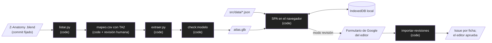

# Atlas 3D de cerebro y nervio vago: brief

Status: approved  |  Date: 2026-10-11  |  Project type: web

## Problem
Los estudiantes de psicología y ciencias de la salud que estudian el eje cerebro y vago usan atlas 3D sin circuitos funcionales, sin fuentes verificables y casi siempre solo en inglés; queremos que repasen una región completa desde el celular, con fichas revisadas por docentes en español y en inglés.

## Users
- Estudiantes de psicología, neurociencias y ciencias de la salud: grupo principal, estudian sobre todo desde celulares económicos.
- Docentes revisores: validan el contenido pieza por pieza (F24). Son los primeros usuarios, junto con sus estudiantes, en el piloto.
- Docentes que muestran estructuras en clase; público general.
- Andrés: creador y editor del contenido; aprueba todo cambio anatómico.

## Why now
Z-Anatomy publicó un atlas abierto (CC BY-SA 4.0) que ya trae el vago, los núcleos del tronco y casi todo el inventario del cerebro, con Terminologia Anatomica en español y latín. Hay docentes identificados para revisar. Construir el visor sobre esa base es viable hoy sin presupuesto.

## Current workaround and its cost
Láminas impresas, la app de Z-Anatomy (anatomía descriptiva, sin circuitos ni fichas con evidencia), Kenhub (de pago, en inglés) y videos sueltos. El estudiante junta fuentes por su cuenta y no sabe cuáles están revisadas.

## Alternatives considered
| Option | Why not (or why yes) |
|---|---|
| Don't build | No existe una herramienta que cubra los cuatro diferenciales del SPEC (sección 2) |
| Buy / configure: modelo en Sketchfab con anotaciones más un sitio estático de fichas | Sale en dos semanas, pero no permite fragmentar, aislar, búsqueda bilingüe cruzada ni recorrido guiado: pierde tres de los cuatro diferenciales |
| Approach A: app web propia (SPA estática) sobre el modelo de Z-Anatomy | Elegida |
| Approach B: extender la app de Z-Anatomy (Unity) | Unity en web pesa demasiado para celulares de gama baja y ata el proyecto a otro código base |

## Recommendation
Go, porque el modelo trae casi todo lo necesario (verificado en la fase 0), ninguna herramienta existente cubre los diferenciales, el costo de operación es cero (sitio estático) y el riesgo principal (contenido incorrecto) tiene un mecanismo de control propio (F24 más aprobación del editor).

## System
- Input: `Startup.blend` de Z-Anatomy (commit fijado) y el contenido redactado y revisado.
- Processing: el pipeline extrae la geometría a `atlas.glb` sin mover piezas; la app carga GLB y JSON en el navegador.
- Output: sitio estático en GitHub Pages; revisiones docentes en una hoja de cálculo del editor, convertidas en issues.
- Workflow or agent: workflow sin IA en el producto, because no hay ningún paso que requiera interpretar entradas no estructuradas (docs/adr/0002-sin-ia-flujo-fijo.md).

## Core journeys (MVP)
1. Un estudiante abre el atlas en el celular, filtra el sistema límbico, separa sus piezas, lee la ficha del hipocampo y reensambla.
2. Un estudiante busca "cranial nerve X" con la interfaz en español y llega al nervio vago, con su ficha y sus núcleos.
3. Un docente abre su enlace de revisión, marca campos de una ficha como correctos o propone cambios, ubica un marcador y envía la revisión.

## First milestone
- Hito 1 (piloto con docentes), en orden: esqueleto, pipeline de la fase 0, F1 + F2, F4 + F5 + F9 + marcadores, F24, F6 + F7, F3 + F10 + F11.
- Success signal: en el Android de gama baja, un estudiante fragmenta, abre fichas de 10 piezas (incluido el vago) y reensambla, a 30 cuadros por segundo o más.

## Non-functional requirements
- 30 cuadros por segundo o más en HP Iris Xe, iPhone 12 Pro Max y Android de gama baja.
- `atlas.glb` de 15 MB o menos.
- Ninguna pieza se corre más de 0,1 mm frente a Blender (verificado en CI).
- Español e inglés completos, con paridad de claves verificada en CI.

## Constraints
- Deadline: ninguno.
- Budget: USD 0 al mes (GitHub Pages, formulario de Google gratuito).
- Team and maintenance: Andrés como editor; Claude Code construye; docentes revisan.
- Integrations and credentials: Google Forms y Sheets del editor (sin credenciales en el repo; la importación de revisiones se hace desde un CSV exportado o desde una sesión con acceso a Drive).

## Security and data
- Data stored: ninguna en servidor. En el navegador del usuario: notas, progreso y revisión en curso (IndexedDB). En la hoja del editor: nombre, rol y respuestas de los revisores (personal, con consentimiento).
- Auth model: none. El código del enlace de revisión solo atribuye, no protege.
- Secrets: ninguno en la app.
- External input trusted: el contenido de las revisiones (texto libre de docentes) nunca se publica sin aprobación del editor.

## Stack
| Layer | Choice | Version | Docs |
|---|---|---|---|
| Runtime | Node.js LTS | 24 | https://nodejs.org |
| Lenguaje | TypeScript estricto | 6.0.3 | https://www.typescriptlang.org/docs/ |
| Base | Vite, React | 8.3.4, 19.3.0 | https://vite.dev, https://react.dev |
| 3D | three, @react-three/fiber, @react-three/drei | 0.186.1, 9.8.1, 10.7.9 | https://threejs.org/docs/, https://r3f.docs.pmnd.rs |
| Estado | zustand | 5.0.15 | https://zustand.docs.pmnd.rs |
| Rutas | react-router | 8.4.0 | https://reactrouter.com |
| Idiomas | i18next, react-i18next | 26.4.3, 17.0.16 | https://www.i18next.com |
| Búsqueda | fuse.js | 7.5.0 | https://www.fusejs.io |
| Local | idb-keyval | 6.3.0 | https://github.com/jakearchibald/idb-keyval |
| Pruebas | Vitest, Playwright | 5.0.3, 1.64.0 | https://vitest.dev, https://playwright.dev |
| Pipeline | Python, bpy, gltf-transform | 3.13, 5.2.2, 4.5.1 | https://docs.blender.org/api/current/, https://gltf-transform.dev |

Hosting: GitHub Pages.

## Operation
- Tools: Claude Code.
- Autonomy: auto.
- Paid services approved: none.
- Nightly cloud routine: opcional, la configura el editor (docs/CLOUD.md en el repo de Rockbuilt).

## Key decisions
- Stack SPA con Vite, React y R3F (docs/adr/0001-stack.md).
- Sin IA en el producto, flujo fijo (docs/adr/0002-sin-ia-flujo-fijo.md).
- Geometría y contenido separados, sin backend (docs/adr/0003-datos-sin-backend.md).
- Pipeline con fuente fijada e invariante de posición verificada (docs/adr/0004-pipeline-geometria.md).
- Hosting en GitHub Pages (docs/adr/0005-hosting-github-pages.md).
- Vago como pieza por lado más marcadores (docs/adr/0006-vago-y-faltantes.md).
- Licencias: código MIT, modelo y contenido CC BY-SA 4.0 (docs/adr/0007-licencias.md).
- Revisión docente por formulario de Google (docs/adr/0008-revision-docente.md).

## Out of scope
See docs/v2.md. Hard non-goals:
- Cuentas de usuario, backend propio o datos personales de usuarios en servidor.
- Resto del cuerpo, histología, contenido clínico o diagnóstico.
- Geometría inventada.

## Open items
- BLOCKING para el piloto (no para construir): nombres de los docentes revisores (SPEC 15.2).
- ADVISORY: dirección visual del SPEC sección 11 (default: la propuesta tal cual).
- DEFERRED: nombre, dominio y analítica (antes del hito 2, docs/v2.md).
- DEFERRED: completar geometría faltante con SPL/NAC, BodyParts3D o SPARC (fase 2, docs/v2.md).
