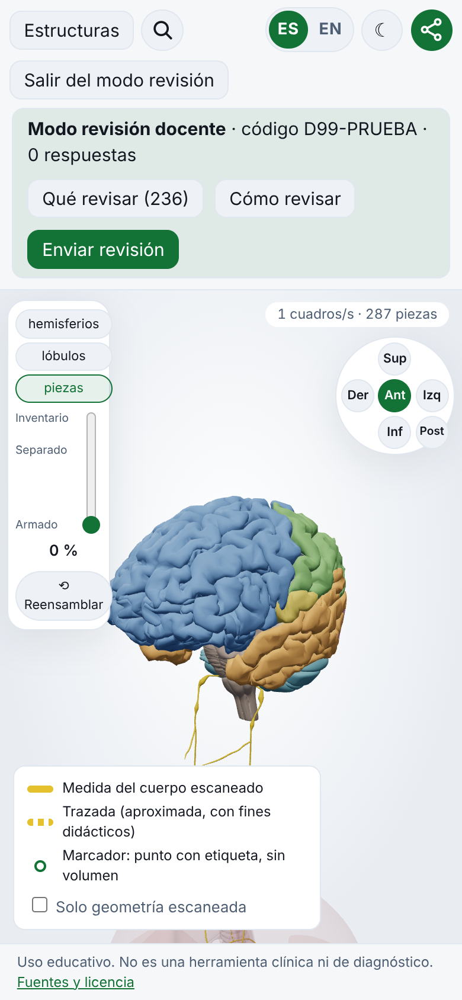
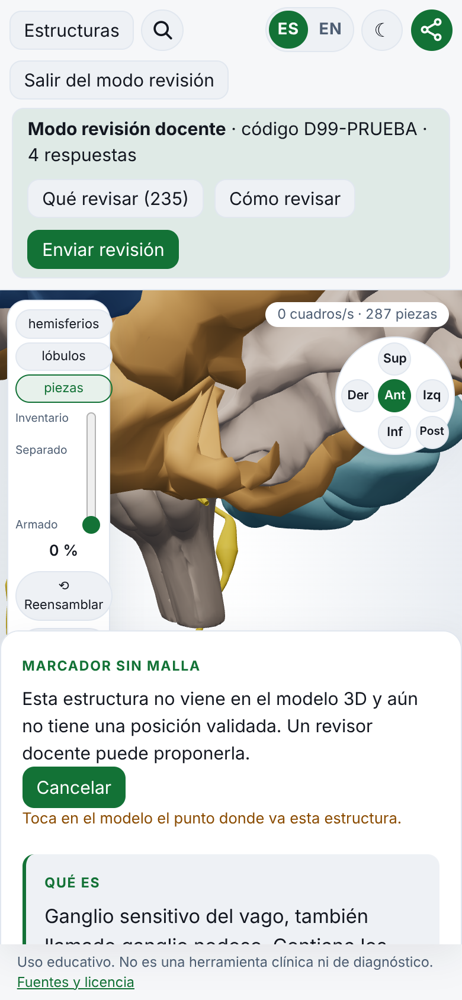
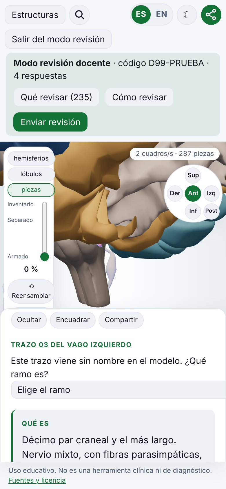
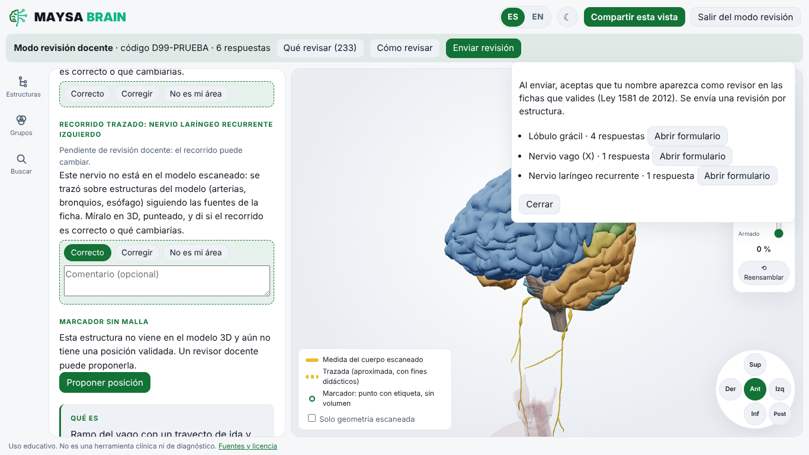
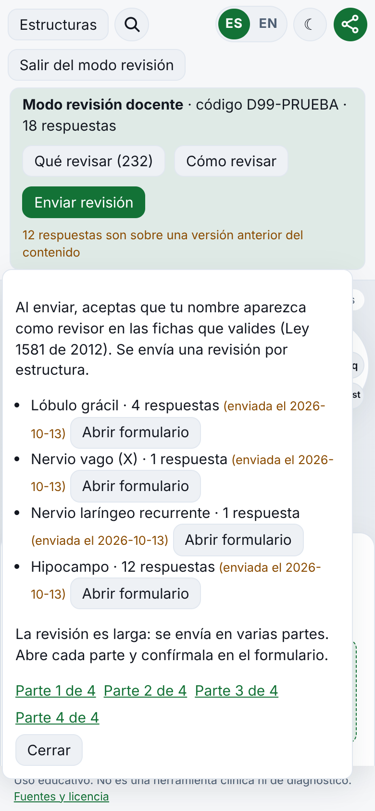

# Auditoría UX de la revisión docente (F24)

Fecha: 13 de octubre de 2026. Método: recorrido completo con Playwright en Chromium (WebGL por software), en escritorio (1366x768) y celular (390x844), entrando con un código de prueba (`/es/revision?r=D99-PRUEBA`). No se envió ningún formulario: docs.google.com quedó bloqueado y se registraron las URL generadas. Las rutas trazadas del vago se probaron con el fixture sintético, porque `public/modelos/rutas-vago.json` está vacío.

## Lo que se midió

- **Entrada:** la guía se abre sola la primera vez. "Qué revisar" muestra 236 fichas en cuatro secciones: dudas (31), vago (16), grupos (64) y resto (125). Desde la lista se llega a la ficha en 2 toques.
- **Revisar:** responder una duda y 3 campos, uno corregido con comentario, costó 6 toques más lo escrito. Una ficha completa puede tener 15 campos y medir unos 4070 px de alto.
- **Enviar:** sale un formulario por ficha. 3 fichas dieron 3 URL de 1406, 630 y 549 caracteres. Una revisión larga (12 correcciones en una ficha) se partió en 4 partes.
- **Almacenamiento:** al borrar los datos del navegador, el contador volvió a 0 sin aviso. Una pestaña nueva sin `?r` no entra en modo revisión.

## Fricciones principales

1. **Un formulario por ficha.** Con 20 fichas son 20 pestañas y unos 60 toques (`PanelRevision.tsx`). Ver la captura de envío y la de partes.
2. **"Enviada" se marca al abrir el formulario**, no al confirmarlo. Las partes no muestran cuáles se abrieron.
3. **La lista no dice qué falta dentro de cada ficha:** una sola respuesta la saca de "Qué revisar".
4. **Los 28 trazos del vago no se encuentran:**
   - no están en la lista; solo aparecen si el docente toca un nervio delgado;
   - en celular el selector se sale de la hoja;
   - el trazo no admite comentario.
5. **Proponer posición no confirma ni deja deshacer.** Un toque por error queda como respuesta.
6. **El progreso es frágil:**
   - solo vive en este navegador, sin aviso ni respaldo;
   - el código se pierde en pestañas nuevas.
7. **En celular la barra de revisión ocupa el 29 % de la pantalla.** Con la ficha abierta, el visor queda en unos 290 px.
8. **Los diálogos no llevan el foco** y Escape no los cierra. Los comentarios usan el placeholder como etiqueta y se guardan solo al salir del campo.
9. **Textos:**
   - la guía en inglés no coincide con los botones;
   - "Al enviar, aceptas que tu nombre aparezca" confunde el envío con el consentimiento, que se da en el registro (Ley 1581 de 2012);
   - nada explica cómo revisar la versión en inglés.
10. **Botones de veredicto:** 29 px de alto, por debajo de los 44 px recomendados para el dedo.

Lo que funciona bien:
- el orden de prioridad;
- la duda dentro de la ficha;
- el reenvío no duplica respuestas (el importador se queda con la última);
- el corte en partes;
- no hace falta servidor propio.

| Barra en celular | Ubicar un marcador | Trazo del vago |
|---|---|---|
|  |  |  |

| Enviar | Partes |
|---|---|
|  |  |

## Canal de retorno

| Opción | Fricción docente | Privacidad | Confiabilidad | Importación |
|---|---|---|---|---|
| Formulario prellenado por ficha (hoy) | Alta: una pestaña por ficha | Google como encargado; registro aparte | Límite de URL (unos 7000 caracteres), sin confirmación | CSV, ya existe |
| El mismo formulario con un solo envío (JSON compacto, partido solo si no cabe) | Baja: 1 a 3 envíos | Igual | Igual, con muchas menos partes | Adaptar el importador a v:2 |
| Apps Script (`doPost`) en el Google del editor, con el formulario de respaldo | Mínima: 1 toque, con "recibido" | Igual (Drive del editor); pide ADR | Sin límite de URL; validar código y ritmo | La misma hoja |
| Tally o Typeform | Igual al formulario | Suma un tercero | Los mismos límites | CSV |
| GitHub issues o giscus | Muy alta: cuenta de GitHub | Público | Límite de URL | Ya en GitHub |
| Correo (mailto) | Media | Correo del docente | El cuerpo se corta | Manual |

**Recomendación:** seguir con el formulario de Google, pero con un solo envío para todo (#58): no cambia el canal ni la privacidad y baja la fricción de N formularios a 1 a 3. Después, el Apps Script con confirmación real y el formulario como respaldo, con ADR. Esa decisión es del editor (#67).

## Mejoras abiertas

| Prioridad | Issue | Mejora |
|---|---|---|
| P1 | #58 | Enviar todo en un paso y marcar "enviada" solo al confirmar |
| P1 | #59 | Avance por ficha en "Qué revisar" |
| P1 | #60 | Respaldo del progreso y código que no se pierde |
| P1 | #61 | Confirmar la posición propuesta con Deshacer |
| P2 | #62 | Trazos del vago en "Qué revisar" con siguiente y comentario |
| P2 | #63 | Barra compacta en celular y salir con confirmación |
| P2 | #64 | Diálogos accesibles y propuestas que no se pierden |
| P2 | #65 | Textos claros (guía en inglés, consentimiento, idioma) |
| P3 | #66 | Botones de 44 px y "Marcar todo como correcto" |
| Decisión | #67 | Canal de retorno: formulario o Apps Script |
| Local | #68 | Revisar que el formulario acepte docentes externos |
