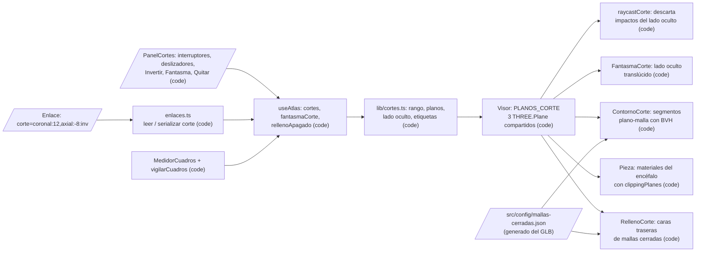

# Design: Planos de corte (F8)

Status: approved  |  Date: 2026-10-13  |  Requirements: ./requirements.md
ADRs: docs/adr/0011-relleno-corte-caras-traseras.md

Every item below cites the requirement IDs it serves. Anything without an R reference does not
belong here.

## Overview
El estado de los cortes vive en el store (`useAtlas`): tres planos fijos (sagital, coronal y axial), cada uno con interruptor, posición en mm desde el centro de la caja del cerebro e "Invertir", más el fantasma (R1, R5). Al activar el primer plano, el store reensambla y bloquea explosión, inventario y Separar (R2). El visor traduce ese estado a tres `THREE.Plane` compartidos, que solo reciben los materiales de las piezas del encéfalo; el vago y los órganos no se tocan (R2.1). La cara del corte se dibuja así (ADR 0011):
- en las mallas cerradas, con una copia de caras traseras en color plano;
- en las abiertas, con un contorno calculado con el BVH que ya existe (R3).

El toque y el cursor usan un raycast que descarta lo que queda del lado oculto, y así la cara del corte se puede tocar (R4). El enlace lleva `corte=` (R7). Un vigilante de cuadros por segundo apaga el relleno si el equipo no da (R8).

## Architecture


| Node / component | Kind | Responsibility | Location | Serves |
|---|---|---|---|---|
| Estado de cortes | code | `cortes`, `fantasmaCorte`, `rellenoApagado`; acciones `setCorte`, `quitarCortes`, `setFantasmaCorte`, `apagarRelleno`; guardas en `setExplosion` y `separar` | `src/store/useAtlas.ts` | R1.3, R1.6, R1.8, R2.2, R2.3, R2.4, R5.1, R8.2 |
| Lógica de cortes | code | Funciones puras: rango del cerebro, plano three desde el estado, lado oculto, etiqueta en mm con dirección, piezas cruzadas por un plano, `vigilarCuadros` | `src/lib/cortes.ts` | R1.2, R1.4, R1.5, R1.7, R2.1, R4.3, R8.2 |
| Planos compartidos | code | `PLANOS_CORTE`: tres `THREE.Plane` mutados en sitio; los inactivos quedan lejos (no recortan) para no recompilar shaders al prender o apagar uno | `src/components/recorte.ts` | R1.4, R8.1, R8.3 |
| Materiales del encéfalo | code | `clippingPlanes={hayCortes && esEncefalo ? PLANOS_CORTE : null}`; el vago conserva `PLANOS_RECORRIDO` | `src/components/Visor.tsx` (Pieza) | R2.1, R2.5, R2.6, R8.3, R9.1 |
| RellenoCorte | code | Por pieza cerrada, visible y cruzada por algún plano: una malla hermana con la misma geometría, `side: BackSide`, `MeshBasicMaterial` del color de la pieza y los mismos planos | `src/components/Visor.tsx` | R3.1, R3.2, R3.5 |
| ContornoCorte | code | Para las mallas abiertas (o para todas si el relleno está apagado): `boundsTree.shapecast` con cada plano activo arma los segmentos de intersección en un `LineSegments` del color de la pieza; se recalcula una vez por cuadro como máximo mientras se arrastra | `src/components/ContornoCorte.tsx` | R3.3, R3.4 |
| FantasmaCorte | code | Si el fantasma está activo: copia de cada pieza cruzada, con los planos negados y `clipIntersection: true` (dibuja solo el lado oculto), opacidad 0,2, sin escribir profundidad y con `raycast` nulo | `src/components/Visor.tsx` | R5.2, R5.3 |
| raycastCorte | code | Envuelve `acceleratedRaycast` y descarta impactos cuyo punto queda del lado oculto de algún plano activo. Un rayo que entra por la cara del corte pega en la cara trasera de esa pieza, que sí es visible: así se toca el relleno | `src/components/Visor.tsx` | R4.1, R4.2, R4.3 |
| Lista de mallas cerradas | code | Script que lee el GLB, suelda vértices por posición (6 decimales) y lista las mallas del encéfalo sin aristas de borde. Hoy: 191 cerradas (510.094 triángulos) y 62 abiertas (185.398). `check:modelo` verifica que la lista coincida | `scripts/mallas-cerradas.ts`, `src/config/mallas-cerradas.json` | R3.2 |
| PanelCortes | code | Panel flotante (escritorio) o cajón inferior (celular), con el aviso del cuerpo único; textos en `cortes.*` de es.json y en.json | `src/components/PanelCortes.tsx`, `src/components/Pagina.tsx`, `src/i18n/*.json` | R1.1, R1.5, R1.8, R1.9, R6.1 a R6.7 |
| Enlaces | code | `EstadoEnlace.corte`; `serializar` y `leer` con validación por entrada | `src/lib/enlaces.ts` | R7.1, R7.3, R7.4 |
| Aplicar enlace | code | Al cargar el modelo, valida las entradas contra el rango del cerebro y llama a `setCorte` | `src/components/Pagina.tsx` | R7.2, R7.3 |
| vigilarCuadros | code | Con cortes activos y 10 muestras seguidas de menos de 30 cuadros por segundo (una cada 0,5 s, o sea 5 s), llama a `apagarRelleno` una sola vez por sesión | `src/lib/cortes.ts`, `MedidorCuadros` | R8.2 |

## Workflow vs agent
Workflow, because todo es cálculo determinista en el navegador; no hay IA en el producto (ADR 0002).

## UI
- **Escritorio:** botón "Cortes" en el riel, debajo de Buscar. Abre un panel flotante junto al riel con:
  - el aviso del cuerpo único (R6.4);
  - tres filas (Sagital, Coronal, Axial), cada una con interruptor, deslizador `input type=range` (paso 1 mm, `aria-valuetext` con la etiqueta en mm), la etiqueta visible y "Invertir" (R1.1, R1.5, R1.6, R1.9);
  - "Fantasma" (R5.2) y "Quitar cortes" (R1.8).

  El mismo botón o Escape lo cierran sin quitar los cortes (R6.1, R6.5).
- **Celular:** botón con ícono de corte en el encabezado, junto a la lupa; abre un cajón inferior con el mismo contenido (R6.2).
- **Estados:**
  - Modelo cargando o con error: botón deshabilitado (R6.6).
  - Sin cortes: el panel muestra los interruptores apagados.
  - Con cortes: la barra de explosión y "Separar" de la ficha se ven deshabilitados, con el texto "Se desactivan mientras haya cortes" (R2.3).
  - Relleno apagado por rendimiento: aviso de una línea en el panel (R8.2).
- **Colisiones:** el panel se ubica en la misma columna de los cajones del riel; la prueba E2E de colisiones se amplía con el panel abierto (R6.3).

## Data model / schema impact
- `useAtlas`, campos nuevos (R1, R5, R8.2):
  - `cortes: Record<Plano, { activo: boolean; mm: number; invertido: boolean }>`;
  - `fantasmaCorte: boolean`;
  - `rellenoApagado: boolean`.

  Son solo de sesión y no van a IndexedDB.
- `src/config/mallas-cerradas.json`: archivo nuevo generado del GLB, con la lista de nombres de malla cerradas (R3.2). No es contenido anatómico ni toca `src/data/**`.
- `EstadoEnlace.corte?: EntradaCorte[]` (R7.1).
- Retención: nada se guarda fuera de la URL compartida.

## Interfaces and contracts
```ts
// src/lib/cortes.ts
export const PLANOS = ['sagital', 'coronal', 'axial'] as const;
export type Plano = (typeof PLANOS)[number];
export interface Corte { activo: boolean; mm: number; invertido: boolean }
export type Cortes = Record<Plano, Corte>;
export interface Rango { centro: Vec3; min: Record<Plano, number>; max: Record<Plano, number> } // mm enteros

/** Caja del cerebro (unión de las cajas de las piezas de g-brain) y rango en mm por eje. (R1.2) */
export function rangoCerebro(cajas: Record<string, Caja>, piezas: string[]): Rango;
/** Normal y constante del plano. Por defecto esconde el lado positivo: +X izquierdo, +Z anterior, +Y superior. (R1.7, R1.6) */
export function planoDe(plano: Plano, c: Corte, rango: Rango): { normal: Vec3; constante: number };
/** true si el punto queda del lado oculto de algún plano activo. (R1.4, R4.3) */
export function ocultoPorCortes(p: Vec3, cortes: Cortes, rango: Rango): boolean;
/** "12 mm anterior", "8 mm inferior", "en el centro". (R1.5) */
export function etiquetaCorte(plano: Plano, mm: number, t: TFunction): string;
/** Piezas cuya caja cruza algún plano activo. (R3.1, R5.2) */
export function piezasCruzadas(cajas: Record<string, Caja>, piezas: string[], cortes: Cortes, rango: Rango): string[];
/** Devuelve true en la muestra que debe apagar el relleno; luego, siempre false. (R8.2) */
export function vigilarCuadros(estado: { bajas: number; apagado: boolean }, fps: number, hayCortes: boolean): boolean;

// src/lib/enlaces.ts
export interface EntradaCorte { plano: Plano; mm: number; invertido: boolean }
// corte=coronal:12,axial:-8:inv  (cada entrada: ^(sagital|coronal|axial):(-?\d{1,4})(:inv)?$)
```

| Endpoint / function | Input | Output | Errors | Serves |
|---|---|---|---|---|
| `setCorte(plano, parcial)` | plano y cambios | estado nuevo; si es el primer activo: `explosion=0`, `separadas={}`, `inventario=false` en la misma actualización | `mm` fuera de rango: se ajusta al borde | R1.3, R2.2 |
| `quitarCortes()` | nada | los tres planos inactivos | ninguno | R1.8, R2.4 |
| `setExplosion`, `separar` | lo de hoy | sin efecto mientras haya cortes | ninguno | R2.3 |
| `leer(search).corte` | `corte=` | entradas válidas en forma, sin duplicados (gana la primera) | entrada mal escrita: se ignora | R7.3 |
| `validarCortes(entradas, rango)` | entradas y rango | solo las que caben en el rango | fuera de rango: se ignora | R7.3 |
| `serializar(e)` | estado con cortes activos | `corte=plano:mm[:inv],...` en el orden sagital, coronal, axial | ninguno | R7.1 |

## Error handling
| Failure | Scope (per item / fatal) | Response | Retry (backoff, max) | Serves |
|---|---|---|---|---|
| El modelo no carga o WebGL falla | fatal para cortes | botón Cortes deshabilitado; el resto de la app sigue igual que hoy | el reintento existente del visor | R6.6 |
| El material de relleno no compila (`renderer.debug.onShaderError`) | por equipo | `apagarRelleno()`: contorno en todas las piezas cortadas, sin errores en consola | ninguno | R3.4 |
| Promedio menor de 30 cuadros por segundo por 5 s con cortes | por equipo | apaga el relleno una vez y lo avisa en el panel | ninguno (no se vuelve a prender en la sesión) | R8.2 |
| Entrada de `corte=` inválida, repetida o fuera de rango | por entrada | se ignora esa entrada; las demás se aplican | no aplica | R7.3 |
| Enlace con `corte=` y `explosion=` | por enlace | gana el corte: el cerebro queda armado | no aplica | R7.4 |

- Idempotency: aplicar el mismo enlace dos veces deja el mismo estado (R7.2).
- Concurrency limit: el contorno se recalcula como máximo una vez por cuadro durante el arrastre (R8.1).
- Cleanup: al quitar los cortes se desmontan las mallas de relleno, fantasma y contorno, y se liberan las geometrías de contorno (R8.3).

## Security considerations
- Authn/authz: no aplica (sin backend ni cuentas).
- Input validation: `corte=` se valida con una expresión anclada y rangos numéricos antes de tocar el estado (R7.3).
- Secrets: ninguno.
- Personal data: ninguno; el estado de cortes no se guarda.
- New dependencies and their risk: ninguna (three-mesh-bvh ya está en el stack).
- Security gate required: no, porque no hay entrada nueva aparte del parámetro de URL validado.

## Testing strategy
| Level | What | Covers |
|---|---|---|
| unit | `tests/cortes.test.ts`: rango, plano por eje y lado, invertir, varios planos, etiqueta, piezas cruzadas (sin vago ni órganos), lado oculto, `vigilarCuadros` | R1.2 a R1.7, R2.1, R4.3, R8.2 |
| unit | `tests/store.test.ts` ampliado: primer corte reensambla; explosión y separar bloqueados; quitar reactiva; ocultas y aislamiento se respetan; posiciones intactas; fantasma por defecto apagado | R1.3, R1.8, R2.2 a R2.6, R5.1 |
| unit | `tests/enlaces.test.ts` ampliado: serializar y leer `corte=`, entradas inválidas o repetidas, corte con explosión | R7.1, R7.3, R7.4 |
| unit | `tests/cortes-visor.test.ts`: con relleno apagado o error de shader, el contorno cubre todas las piezas; sin cortes no hay planos en materiales ni mallas extra; el fantasma usa opacidad de 0,25 o menos y `raycast` nulo | R3.4, R5.2, R5.3, R8.3 |
| unit | `npm run check:i18n` con las claves `cortes.*` | R6.7 |
| integration | `check:modelo`: `src/config/mallas-cerradas.json` coincide con las mallas sin bordes del GLB | R3.2 |
| e2e | `e2e/cortes.spec.ts`: panel, tres planos, teclado, quitar, controles deshabilitados, corte coronal en el tálamo con nombres (helpers DEV `__cortes` y `__puntoCorte(pieza)`), tocar la cara abre la ficha, celular, colisiones, aviso, Escape, botón deshabilitado sin modelo, enlace con `corte=`, recorrido con cortes | R1.1, R1.8, R1.9, R2.3, R3.5, R4.1, R4.2, R6.1 a R6.6, R7.2, R9.1 |
| manual | Capturas del relleno y del contorno en el prototipo (#9) y en los equipos de referencia; cuadros por segundo con 3 planos y `?medir=1`, pegados en #6 | R3.1, R3.3, R8.1 |

## Risk and cost
| Item | Why tier C | Cost estimate (monthly) | Serves |
|---|---|---|---|
| SPEC.md sección 10 ("Planos de corte"): cambia stencil por caras traseras y contorno con BVH | archivo sensible; va en el PR del spec | none | R3 |
| ADR 0011 | decisión de arquitectura | none | R3 |

El resto es tier B: código de producción desde un spec aprobado, sin dependencias nuevas, sin datos de `src/data/**` y sin tocar el GLB. La lista de mallas cerradas se genera del GLB, pero no lo modifica.

Paid services this feature needs: none.

## Alternatives considered
| Option | Why rejected |
|---|---|
| Relleno con stencil (decisión 2 original) | 3 dibujos extra por malla cerrada y por plano (estimado unas 360 con 3 planos) y `stencil: true` en el contexto; el editor eligió caras traseras el 13 de octubre de 2026 (ADR 0011) |
| Tapas geométricas exactas (triangular la sección de cada pieza en cada movimiento) | Mucho cálculo por cuadro con 191 piezas y falla con las mallas abiertas |
| Cortar con explosión activa | No corresponde a ningún corte anatómico (decisión 1) |
| Cortar todo el modelo | Rango de 1,5 m y nada que ver en el cerebro con un corte torácico (decisión 3) |
| Prender y apagar planos cambiando cuántos recibe cada material | Cada cambio recompila los shaders de 253 materiales; se usan siempre 3 planos y los inactivos se dejan lejos |

## Open questions
- BLOCKING: none.
- ADVISORY: opacidad del fantasma (default: 0,2).
- ADVISORY: umbral del vigilante (default: 10 muestras de 0,5 s bajo 30 cuadros por segundo).
- ADVISORY: el relleno con caras traseras muestra las piezas anidadas dentro del relleno (por ejemplo, el plexo coroideo dentro del ventrículo); se confirma con capturas en el prototipo (default: aceptarlo, porque es lo que muestra un corte real).
