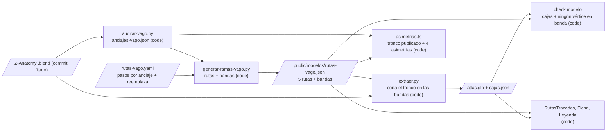

# Design: Vago torácico trazado (ADR 0010)

Status: approved  |  Date: 2026-10-13  |  Requirements: ./requirements.md
ADRs: docs/adr/0010-vago-toracico-trazado.md (accepted; este diseño lo implementa, sin ADR nuevo)

Every item below cites the requirement IDs it serves. Anything without an R reference does not
belong here.

## Overview
`rutas-vago.yaml` suma dos rutas, `vago_toracico_derecho` y `vago_toracico_izquierdo` (R1.1). Cada una declara qué tramo del tronco escaneado reemplaza, siempre entre alturas de anclajes (R2.4). `generar-ramas-vago.py` resuelve las rutas, hace salir los recurrentes del tramo trazado y empalma el vago izquierdo distal con el torácico izquierdo (R1.2 a R1.4). Además escribe en `public/modelos/rutas-vago.json`, junto a cada ruta torácica, la banda de alturas que reemplaza (R1.6, R2.4). `extraer.py` lee esas bandas y corta la malla del tronco escaneado (y su `#toque`) con planos horizontales, sin mover ningún vértice que quede (R2.1 a R2.3, R2.5). `check:modelo` vigila que ninguna malla publicada del tronco tenga vértices dentro de una banda (R2.6, R2.7). La prueba de asimetrías arma el tronco publicado de cada lado (escaneado fuera de la banda más lo trazado) y comprueba las cuatro asimetrías sobre él con el `anclajes-vago.json` real, que entra al repo (R3). La app ya dibuja las rutas con acabado aproximado y recorrido (R4). Solo cambian la leyenda y el campo de revisión, que pasa a ser uno por ruta (R5).

## Architecture


| Node / component | Kind | Responsibility | Location | Serves |
|---|---|---|---|---|
| Rutas torácicas | data | Dos rutas nuevas con pasos por anclaje y bloque `reemplaza` (lado, `desde` y `hasta` como alturas de anclaje); los recurrentes arrancan con `desde_ruta`; el distal izquierdo arranca en el final del torácico izquierdo | `pipeline/rutas-vago.yaml` | R1.1, R1.3, R1.4, R2.4 |
| Pasos nuevos del generador | code | `desde_ruta: {ruta, a_la_altura_de | punto: final}` y `hasta_vago: {lado, a_la_altura_de}`, que cierra la ruta en el tronco escaneado; resolución de rutas en orden de dependencia; falla nombrando el anclaje o la ruta que falta sin escribir nada | `pipeline/generar-ramas-vago.py` | R1.2, R1.3, R1.4, R1.5 |
| Bandas reemplazadas | code | `generar()` agrega por ruta torácica `reemplaza: {lado, y_max, y_min}` (izquierdo: `y_min` nulo, es decir hasta abajo), resuelto con las mismas medidas de anclajes | `pipeline/generar-ramas-vago.py`, `public/modelos/rutas-vago.json` | R1.6, R2.4 |
| Corte del tronco | code | Para `Vagus nerve (X).l/.r#t02` y su `#toque`: tras convertir a malla, `bmesh.ops.bisect_plane` en `y_max` y `y_min` (Z en Blender), y borra las caras dentro de la banda. Los vértices existentes no se tocan; los nuevos caen sobre la superficie original. Llaves de malla sin cambios (el derecho queda en dos componentes dentro de la misma malla) | `pipeline/extraer.py` | R2.1, R2.2, R2.3, R2.5 |
| Prueba del corte | code | En Blender sobre el .blend en caché: cada vértice conservado es idéntico al original y ninguno queda dentro de la banda | `pipeline/pruebas/probar_recorte.py` | R2.5 |
| Vigilancia en check:modelo | code | Lee las bandas de `rutas-vago.json` (`huecos` y `reemplaza`, Plan B), exige una por lado y falla si una malla del tronco (o su toque) tiene un vértice dentro de la banda de su lado, con 0,1 mm de tolerancia; nombra malla y altura. Presupuesto de 15 MB igual que hoy | `scripts/check-modelo.ts`, `scripts/lib/modelo.ts` | R2.6, R2.7 |
| Tronco publicado | code | `troncoPublicado(d, r, lado)`: tronco escaneado sin los puntos de la banda, más las rutas torácica (y distal en el izquierdo), ordenado de arriba abajo; `bandaContiene()` para R3.3; `asimetria3` y `asimetria4` usan el tronco publicado | `scripts/lib/asimetrias.ts` | R3.1, R3.3 |
| Prueba con el modelo real | code | Plan B (2026-10-18): con `pipeline/anclajes-vago.json` y `public/modelos/rutas-vago.json` del repo (sin rutas), los `huecos` coinciden con las alturas de los anclajes, cubren la cima del arco y el centro del bronquio derecho, y nada escaneado conservado llega a esas alturas. Cuando se publiquen las rutas: las cuatro asimetrías pasan, los empalmes miden 2,5 mm o menos, los recurrentes salen del tramo trazado y el YAML no trae coordenadas | `tests/asimetrias.test.ts`, `tests/rutas-vago-pipeline.test.ts` | R1.1 a R1.4, R1.6, R3.2, R3.4 |
| Leyenda | code | Plan B (2026-10-18): una línea cuando `rutas-vago.json` trae `huecos`: "Hueco en el tórax: el tramo torácico del vago está pendiente de trazado." (i18n es y en). Sin nada trazado, la leyenda esconde la fila "Trazada" y el filtro. Antes de Plan B: "El tramo torácico del vago es trazado; con el filtro de solo escaneada no se muestra" | `src/components/LeyendaOrigen.tsx`, `src/i18n/*.json` | R4.2 |
| Revisión por ruta | code | `campoTrazado(r) = trazado_<id>`; el importador marca como desactualizadas las respuestas a `trazado_derecho` y `trazado_izquierdo` y no las aplica | `src/lib/rutas.ts`, `src/components/Ficha.tsx`, `scripts/lib/revisiones.ts` | R5.1, R5.2, R5.3 |
| Entrada de los tramos | data | `entrada: vagus-nerve-x` en las rutas torácicas (la ficha del vago, que ya existe) | `pipeline/rutas-vago.yaml` | R4.4 |

## Workflow vs agent
Workflow, because todo es cálculo determinista sobre medidas del modelo; no hay IA en el producto (ADR 0002).

## UI
Sin pantallas nuevas.
- Las rutas torácicas se ven como las demás rutas trazadas: mate, punteadas, con aviso y estado en la ficha (R4.1, R4.4).
- Con "Solo geometría escaneada" desaparecen y queda el hueco, y la leyenda suma su línea (R4.2).
- El recorrido las revela con el mismo plano por paradas (R4.3).
- En modo revisión, la ficha muestra un bloque de revisión por ruta en lugar de uno por lado (R5.1).

## Data model / schema impact
- `pipeline/rutas-vago.yaml`:
  - dos rutas nuevas;
  - bloque `reemplaza` en las torácicas;
  - pasos `desde_ruta` y `hasta_vago`.

  Sin coordenadas (R1.1, R2.4).
- `public/modelos/rutas-vago.json` (tier C, sensible): 5 rutas; las torácicas llevan `reemplaza: {lado, y_max, y_min}` (R1.6, R2.4). `src/lib/rutas.ts` acepta el campo opcional.
- `public/modelos/atlas.glb` y `pipeline/cajas.json` (tier C, sensibles): regenerados con los troncos cortados (R2.1 a R2.3, R2.7).
- `pipeline/anclajes-vago.json`: entra al repo (R3.4).
- Revisiones: el campo `trazado_<lado>` queda obsoleto; las respuestas viejas se conservan como desactualizadas (R5.3).

## Interfaces and contracts
```yaml
# rutas-vago.yaml (extracto del contrato)
vago_toracico_derecho:
  lado: derecho
  entrada: vagus-nerve-x
  revision: { estado: en_revision, revisado_por: null, fecha: null }
  reemplaza:
    desde: { anclaje: "Right subclavian artery", punto: mas_alto }
    hasta: { anclaje: "Right main bronchus", punto: mas_bajo }
  pasos:
    - desde_vago: derecho
      a_la_altura_de: { anclaje: "Right subclavian artery", punto: mas_alto }
    # ... pasos por anclaje (detrás del bronquio principal derecho, hacia el esófago) ...
    - hasta_vago: derecho
      a_la_altura_de: { anclaje: "Right main bronchus", punto: mas_bajo }
laringeo_recurrente_derecho:
  pasos:
    - desde_ruta: { ruta: vago_toracico_derecho, a_la_altura_de: { anclaje: "Right subclavian artery", punto: mas_alto } }
vago_izquierdo_distal:
  pasos:
    - desde_ruta: { ruta: vago_toracico_izquierdo, punto: final }
```

```ts
// scripts/lib/asimetrias.ts
export interface Banda { lado: 'izquierdo' | 'derecho'; y_max: number; y_min: number | null }
export function bandas(r: Rutas): Banda[];                                   // R2.4, R3.3
export function troncoPublicado(d: Anclajes, r: Rutas, lado: 'izquierdo' | 'derecho'): P[]; // R3.1
export function puntosEnBanda(pts: P[], b: Banda, tolerancia?: number): P[];  // R3.3
```

| Endpoint / function | Input | Output | Errors | Serves |
|---|---|---|---|---|
| `generar-ramas-vago.py` | YAML + `anclajes-vago.json` | `rutas-vago.json` con 5 rutas y bandas | anclaje o ruta faltante: se detiene nombrándolo, no escribe | R1.2 a R1.6, R2.4 |
| `extraer.py` | .blend + `rutas-vago.json` (bandas) | GLB crudo + `cajas.json` con troncos cortados | falta `rutas-vago.json` o una banda: se detiene, no exporta | R2.1 a R2.3 |
| `check:modelo` | GLB + `cajas.json` + bandas | ok o fallo con malla y altura | malla del tronco con vértice en banda: falla | R2.6, R2.7 |
| `comprobar(d, r)` | anclajes + rutas | las cuatro asimetrías sobre el tronco publicado | anclaje faltante: lanza nombrándolo | R3.1, R3.2 |

## Error handling
| Failure | Scope (per item / fatal) | Response | Retry (backoff, max) | Serves |
|---|---|---|---|---|
| Anclaje o ruta de `desde_ruta` que no existe | fatal | el generador se detiene nombrándolo; no escribe `rutas-vago.json` | no | R1.5 |
| Empalme de más de 2,5 mm | fatal en prueba | la prueba nombra la ruta y el salto | no | R1.2 a R1.4 |
| Banda faltante al extraer | fatal | `extraer.py` se detiene antes de exportar | no | R2.1 a R2.3 |
| Vértice del tronco dentro de la banda | fatal en `check:modelo` | falla con malla y altura | no | R2.6 |
| Asimetría que no pasa con las rutas nuevas | fatal en prueba | se ajustan solo los pasos del YAML (anclajes por nombre), nunca la prueba | no | R3.2 |

- Idempotency: regenerar con las mismas entradas produce los mismos `rutas-vago.json`, GLB y `cajas.json` (R2.5).
- Cleanup: las copias temporales de Blender se borran como hoy en `extraer.py` (R2.1).

## Security considerations
- Authn/authz: no aplica.
- Input validation: `leerRutas` valida el campo `reemplaza` (R1.6).
- Secrets y datos personales: ninguno.
- New dependencies: ninguna (bpy 5.2.2 y pyyaml ya están en `pipeline/requirements.txt`).
- Security gate required: no.

## Testing strategy
| Level | What | Covers |
|---|---|---|
| unit | `tests/asimetrias.test.ts` con el modelo sintético regenerado (5 rutas y bandas): tronco publicado, banda vacía de puntos, las cuatro asimetrías; casos que fallan si un punto queda en la banda o falta un anclaje | R3.1, R3.3 |
| unit | `tests/rutas-vago-pipeline.test.ts` sobre el fixture sintético: empalmes de 2,5 mm o menos, recurrentes desde el tramo trazado, bandas iguales a las alturas de los anclajes, YAML sin coordenadas | R1.1 a R1.4, R2.4 |
| unit | `pipeline/pruebas/probar_generar.py`: pasos nuevos, falla nombrando anclaje o ruta y sin escribir | R1.5 |
| unit | `tests/rutas.test.ts` (5 rutas, `reemplaza` opcional, `campoTrazado` por ruta) y `tests/revisiones.test.ts` (respuesta por ruta y campo viejo desactualizado) | R5.1, R5.2, R5.3 |
| integration | `npm test` con `pipeline/anclajes-vago.json` y `public/modelos/rutas-vago.json` reales: 5 rutas publicadas y las cuatro asimetrías en verde | R1.6, R3.2, R3.4 |
| integration | `npm run check:modelo` con el GLB regenerado: cajas, bandas vacías y 15 MB o menos; `pipeline/pruebas/probar_recorte.py` en Blender: vértices conservados idénticos | R2.1, R2.2, R2.3, R2.5, R2.6, R2.7 |
| e2e | `e2e/vago-toracico.spec.ts`: acabado punteado, filtro con hueco y línea de la leyenda, recorrido parada por parada, tocar un tramo abre la ficha del vago con aviso y estado | R4.1 a R4.4 |
| manual | Un docente aprueba cada ruta y el editor aplica la aprobación | R5.4 |

## Risk and cost
| Item | Why tier C | Cost estimate (monthly) | Serves |
|---|---|---|---|
| `public/modelos/rutas-vago.json` con 5 rutas y bandas | ruta sensible (`public/modelos/**`) | none | R1.6 |
| `public/modelos/atlas.glb` y `pipeline/cajas.json` regenerados | rutas sensibles; geometría publicada | none | R2.1 a R2.3 |
| `pipeline/rutas-vago.yaml` con las rutas torácicas | decisión anatómica que revisa un docente | none | R1.1 |

El resto (generador, `extraer.py`, `check:modelo`, asimetrías, app, importador) es tier B. Las pruebas de Python del pipeline no corren en el CI (no tiene bpy). Lo que vigila el CI está en TypeScript: empalmes, bandas, asimetrías y `check:modelo`.

Paid services this feature needs: none.

## Alternatives considered
| Option | Why rejected |
|---|---|
| Esconder el tramo con planos de recorte en el visor | El tramo falso seguiría en el GLB publicado y tocable; el editor eligió cortarlo en el pipeline (decisión 1) |
| Cortar la curva antes de biselarla (spline) | Cambia el teselado de todo el tronco y mueve vértices; cortar la malla ya biselada no mueve los que quedan |
| Partir el tronco derecho en dos mallas nuevas | Cambia las llaves de malla, el árbol y `mapeo.csv`; una malla con dos componentes no cambia nada de eso |
| Duplicar la lógica de alturas en Python y TypeScript | Dos fuentes que pueden diverger; las bandas se calculan una vez y viajan en `rutas-vago.json` |
| Campo de revisión por lado | El editor eligió uno por ruta (decisión 4) |

## Open questions
- BLOCKING: none.
- ADVISORY: pasos exactos del tramo torácico de cada lado (default: derecho por detrás del bronquio principal derecho hasta la cara posterior del esófago; izquierdo por la cara anterolateral izquierda del arco y detrás del bronquio principal izquierdo). Se ajustan solo en el YAML hasta que pasen las asimetrías y quedan en revisión docente.
- ADVISORY: el cierre del corte deja el tubo abierto en los extremos (default: sin tapa, como el final actual del tronco izquierdo).
