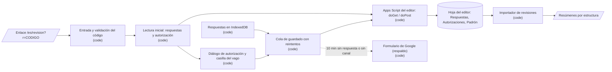

# Design: Canal de retorno de la revisión docente por Apps Script

Status: approved  |  Date: 2026-10-14  |  Requirements: ./requirements.md
ADRs: docs/adr/0012-apps-script-canal-revision.md, actualiza docs/adr/0008-revision-docente.md

Cada elemento cita los requisitos que sirve. Lo que no tiene R no va aquí.

## Overview
La app sigue guardando cada respuesta en IndexedDB, pero ya no espera a que el docente envíe: una cola de guardado manda cada respuesta completa a un Apps Script publicado en la cuenta de Google del editor, 3 s después del último cambio, y la marca "Guardado ✓" solo cuando el script confirma esa versión (R3). El script valida el código contra un padrón privado, el tamaño, el ritmo y el formato, y escribe una fila por envío en la misma hoja que el importador ya sabe leer (R6, R8). Al abrir el enlace, la app trae del script las respuestas ya guardadas de ese código y la autorización vigente; si falta la autorización, la pide una vez con la casilla opcional del vago, que filtra "Qué revisar" (R1, R2, R4, R5). Si el script no responde por 10 min, o no está configurado, la app vuelve al formulario de Google de hoy (R7). Las fichas muestran "Revisado por un docente universitario" sin datos personales (R9).

## Architecture


| Nodo / componente | Tipo | Responsabilidad | Ubicación | Sirve |
|---|---|---|---|---|
| Entrada y validación del código | code | Validar `?r=` con `REVISOR_VALIDO` antes de guardar nada; mensaje si es inválido | `src/components/Pagina.tsx`, `src/lib/persistencia.ts` | R1.1, R1.2 |
| Cliente del canal | code | `leer(codigo)`, `guardar(codigo, respuestas)`, `autorizar(...)` por `fetch`; valida lo que vuelve | `src/lib/canal.ts` (nuevo) | R1.3, R2.3, R3.1, R4.1, R6.6 |
| Cola de guardado | code | Lógica pura: espera de 3 s, reintentos 2 s a 5 min, estado por clave y fecha, aviso de 10 min | `src/lib/colaGuardado.ts` (nuevo) | R3.1 a R3.6, R7.1 |
| Fusión al abrir | code | Mezcla local y canal por fecha más reciente (reusa `fusionarRespuestas`) | `src/lib/respaldo.ts` (se queda solo la fusión) | R4.1, R4.2 |
| Diálogo de autorización | code | Casilla obligatoria, casilla del vago, versión del texto | `src/components/DialogoAutorizacion.tsx` (nuevo) | R2.1, R2.2, R2.4, R2.5, R2.6 |
| Filtro del vago | code | Quitar la sección `vago`, los trazos y los campos de rutas trazadas | `src/lib/prioridad.ts`, `src/components/SeccionTrazos.tsx`, `PanelRevision.tsx` | R5.1, R5.2, R5.3 |
| Panel de revisión | code | "Guardado ✓", "Sin conexión...", sin pasos de envío, sin botones de respaldo, menú Acciones con la casilla del vago | `src/components/PanelRevision.tsx` | R3.2, R3.7, R4.4, R5.3, R7.1, R7.2 |
| Apps Script | code | `doPost` (leer, guardar, autorizar) y `doGet` (responde siempre `formato`, sin leer, #169): padrón, tamaño, ritmo, formato, escritura con bloqueo | `apps-script/Codigo.js` (nuevo, sin datos) | R2.3, R4.3, R6.1 a R6.5 |
| Formulario de respaldo | code | El flujo actual de partes (`partesEnvio`) queda detrás de la condición de R7 | `src/lib/revision.ts`, `PanelRevision.tsx` | R7.1, R7.2 |
| Importador | code | Leer el CSV de la pestaña Respuestas y, con `--autorizaciones`, el de la pestaña Autorizaciones para la casilla del vago (#163); ignorar las filas de otras pestañas que traiga el CSV de respuestas | `scripts/importar-revisiones.ts`, `scripts/lib/revisiones.ts` | R8.1, R8.2 |
| Ficha | code | "Revisado por un docente universitario" y fecha; nunca `revisado_por` | `src/components/Ficha.tsx` | R9.1, R9.2 |
| Prueba de datos | code | `revisado_por` en `src/data/` y en rutas: `null` o un alias `D\d{2}` | `tests/datos.test.ts` | R9.3 |

## Workflow vs agent
Workflow, porque el camino es fijo y conocido: guardar, confirmar, reintentar, leer. No hay IA en el producto (ADR 0002). (R3, R4)

## UI
- **Entrada con enlace inválido:** pantalla con "Este enlace no es válido; pide uno nuevo al editor", sin modo revisión. (R1.2)
- **Código no activo:** aviso en el panel "Tu código no está activo; escribe al editor"; las respuestas siguen en el equipo. (R1.3)
- **Autorización:** diálogo accesible (foco, Escape cierra sin aceptar) con el texto versionado, casilla obligatoria, casilla opcional del vago y botón "Continuar" deshabilitado hasta marcar la obligatoria. Aparece antes del primer guardado, no al entrar, para que el docente empiece a revisar sin barrera. (R2.1, R2.2)
- **Estado de guardado** en la barra del panel, siempre visible, también en celular: "Guardado ✓" / "Guardando..." / "Sin conexión: se guardará cuando vuelva". (R3.2, R3.4)
- **Respaldo:** después de 10 min sin confirmación, un aviso con "Enviar por formulario", que abre el flujo de partes de hoy. (R7.1)
- **Menú Acciones:** casilla "También puedo revisar el recorrido del nervio vago en cuello y tórax". (R5.3)
- **Se retiran:** "Enviar revisión", "Enviar todo", "Abrir formulario", "Sí, lo envié", "Descargar respaldo", "Cargar respaldo", enlace "Registrarme". (R3.7, R4.4, R10.3)
- **Ficha pública:** "Revisado por un docente universitario · <fecha>" cuando el idioma visible está verificado. (R9.1)

## Data model / schema impact
- **IndexedDB `revision:<código>`:** `{respuestas, confirmadas}` se conserva; `confirmadas` pasa a significar "guardadas en el canal" (clave a fecha confirmada). Sin migración: los datos viejos se leen igual. Nuevo campo opcional `autorizacion: {version, vago}` en caché local. (R2.4, R3.3, R3.5)
- **Carga `v:2`:** cada respuesta gana la clave corta opcional `f` (fecha ISO de la respuesta), necesaria para confirmar por versión y para quedarse con la más reciente. El importador la acepta y la ignora si falta, así que las filas viejas siguen siendo válidas. (R3.3, R3.6, R4.2, R8.1)
- **Hoja del editor**, tres pestañas:
  - `Respuestas`: columna A fecha y hora de recepción, B código, C ids de estructura, D carga `v:2` (texto plano). Mismo orden que el CSV del formulario. (R6.4, R8.1)
  - `Autorizaciones`: código, fecha y hora, versión del texto, vago (sí/no). La última fila por código manda. (R2.3, R5.3)
  - `Padrón`: código, alias, activo (sí/no). Privada, la llena el editor. (R6.1)
- **`src/config/revision.ts`:** nueva `urlCanal` (vacía = sin canal, R7.2) y `VERSION_AUTORIZACION`. (R2.5, R7.2)
- **Retención:** las filas viven en la hoja del editor; el editor borra las de un docente si este lo pide (Ley 1581, derecho de supresión), documentado en `docs/revision-docente.md`. (R10.2)

## Interfaces and contracts
```ts
// src/lib/canal.ts (R1.3, R2.3, R3.1, R4.1, R6.6)
type RespuestaCanal =
  | { ok: true; recibidas?: string[]; respuestas?: unknown; autorizacion?: { version: string; vago: boolean } | null }
  | { ok: false; error: 'codigo_no_activo' | 'demasiado_grande' | 'formato' | 'demasiadas_peticiones' | 'sin_autorizacion' | 'interno' };

leer(codigo: string): Promise<{ respuestas: Respuesta[]; autorizacion: Autorizacion | null }>; // POST {accion:'leer', r}
guardar(codigo: string, respuestas: Respuesta[]): Promise<Set<string>>;                       // POST {accion:'guardar', carga v:2}; devuelve "clave|fecha" confirmadas
autorizar(codigo: string, a: { version: string; vago: boolean }): Promise<void>;              // POST {accion:'autorizar', ...}

// src/lib/colaGuardado.ts, lógica pura sin red ni reloj (R3.1 a R3.6, R7.1)
siguienteEspera(intentos: number): number;            // 2000, 4000, 8000, ... tope 300000
pendientes(respuestas, confirmadas): Respuesta[];     // completas y no confirmadas en esa fecha (reusa pendientesDeEnvio)
ofrecerRespaldo(ultimaConfirmacion: number | null, ahora: number, hayPendientes: boolean): boolean; // 10 min
```
| Endpoint | Entrada | Salida | Errores | Sirve |
|---|---|---|---|---|
| `POST <urlCanal>` `{accion:'leer', r}` (el GET ya no lee, #169) | código | `{ok, respuestas (v:2 de ese código, la última por clave), autorizacion}` | `codigo_no_activo`, `demasiadas_peticiones` | R1.3, R2.4, R4.1, R4.3 |
| `POST <urlCanal>` `{accion:'guardar', carga}` (cuerpo `text/plain`) | carga `v:2` con `f` | `{ok, recibidas:["est|campo|idioma|fecha", ...]}` | todos | R3.1, R3.3, R6.1 a R6.4 |
| `POST <urlCanal>` `{accion:'autorizar', r, version, vago}` | código, versión, vago | `{ok}` | `codigo_no_activo`, `formato` (también con una versión distinta de la vigente, #169), `demasiadas_peticiones` | R2.3, R5.3 |

El cuerpo va como `text/plain` para que el navegador no haga petición previa (preflight); el script responde con `ContentService` en JSON. (R3.1)

## Error handling
| Falla | Alcance | Respuesta | Reintento | Sirve |
|---|---|---|---|---|
| Sin red o tiempo agotado (10 s) | por lote | Respuestas siguen pendientes; aviso "Sin conexión" | 2 s, 4 s, 8 s... tope 5 min, sin límite de intentos | R3.4 |
| Script responde `interno` | por lote | Igual que sin red | Igual | R3.4 |
| `demasiadas_peticiones` | por lote | Pendientes; sin aviso extra | Espera 60 s | R6.3 |
| `formato` o `demasiado_grande` (también `formato` por las respuestas del vago de un código sin la casilla, #166) | por respuesta | Se parte el lote; la respuesta que sigue fallando sola queda pendiente y va al respaldo por formulario | No se reintenta esa respuesta | R6.2, R7.1 |
| `codigo_no_activo` | fatal para el canal | Aviso R1.3; respuestas quedan en el equipo | No | R1.3 |
| `sin_autorizacion` (guardar sin autorización vigente en la hoja) | fatal hasta autorizar | Autorización a null, vuelve el diálogo, las respuestas quedan pendientes | No; la cola sigue al aceptar | R2.1, R2.4 |
| 10 min sin confirmación con pendientes | sesión | Aviso con "Enviar por formulario" | La cola sigue intentando | R7.1 |
| `urlCanal` vacía | sesión | Flujo de formulario de hoy | No aplica | R7.2 |
| Respuesta del canal no válida al leer | por respuesta | Se descarta esa respuesta, se registra en consola | No | R6.6 |

- **Idempotencia:** cada respuesta viaja con su clave y fecha; reenviar la misma versión crea otra fila igual y el importador se queda con la última por código, estructura, campo e idioma, así que el resultado no cambia. La lectura del script aplica la misma regla. (R3.6, R4.2)
- **Concurrencia:** el script escribe con `LockService` (una escritura a la vez, espera hasta 10 s); el cliente manda un lote a la vez por pestaña, con hasta 50 respuestas o 60 KB por lote. (R6.2, R6.4)
- **Recarga:** las pendientes viven en IndexedDB; al abrir con el código, la cola arranca sola. (R3.5)

## Security considerations
- **Autorización por código:** el código es privado y actúa como llave; en cada petición (lectura y escritura) el script lo compara con una copia del padrón que guarda unos 60 s (S3, #162). Cada código solo lee sus respuestas. `guardar` exige además que la última fila del código en `Autorizaciones` tenga la versión vigente (S1, #157). (R4.3, R6.1)
- **Validación de entrada:** el script valida tamaño (64 KB), ritmo (120 por minuto por código, con `CacheService`) y la forma `v:2` con las mismas reglas de `respuestaValida`. `guardar` rechaza con `formato` la carga que trae respuestas del vago (`esRespuestaDelVago`) de un código cuya última autorización no marca la casilla del vago (S2, #166). La app valida lo que lee con `respuestaValida`. Una prueba carga `apps-script/Codigo.js` en Node y le pasa los mismos casos hostiles de `tests/revisiones.test.ts`, para que las dos validaciones no se separen. (R6.2, R6.3, R6.6)
- **Inyección en la hoja:** la carga se escribe como texto plano (formato `@`), y el código ya validado con `REVISOR_VALIDO` no puede empezar con `=`, `+`, `-` ni `@`. (R6.4)
- **Secretos:** ninguno. La URL del script es pública por diseño (va en el bundle); sin el código de un docente no sirve. El padrón y los códigos solo viven en la hoja y en `pipeline/revisores.local.json` (ignorado por git). (R6.5)
- **Datos personales:** la app solo envía el código y las respuestas; nunca nombre ni correo. La autorización guarda código, fecha, versión del texto y la casilla del vago. Nada de esto llega al repositorio. (R2.3, R2.6, R9.2, R9.3)
- **Nuevo host externo:** `script.google.com` (y su redirección a `script.googleusercontent.com`). Es tier C y lo aprueba este diseño.
- **Dependencias nuevas:** ninguna.
- **Revisión de seguridad:** sí, por endpoint público, datos personales y host nuevo.

## Testing strategy
| Nivel | Qué | Cubre |
|---|---|---|
| unit | `colaGuardado` (espera, reintentos, versión confirmada, 10 min), fusión por fecha, versión de autorización, carga `v:2` con `f`, importador con la pestaña Respuestas y filas de otras pestañas, filtro del vago en `prioridad`, `revisado_por` en datos, guía sin registro | R2.5, R3.3, R3.4, R3.6, R4.2, R6.6, R8.1, R8.2, R9.3, R10.3 |
| unit (script) | `apps-script/Codigo.js` cargado en Node con dobles de `SpreadsheetApp`, `CacheService` y `LockService`: padrón, tamaño, ritmo, formato, columnas, sin datos personales en el archivo | R6.1 a R6.5 |
| integration | El mismo script contra una hoja doble con las tres pestañas: autorizar escribe la fila; leer devuelve solo lo del código | R2.3, R4.3 |
| e2e | Playwright con el canal simulado por `page.route` sobre `urlCanal`: entrada válida e inválida, código no activo, autorización (obligatoria, no se repite, sin datos personales), guardado y "Guardado ✓", sin conexión y reintento, recarga con pendientes, otro equipo (contexto nuevo) trae lo guardado, filtro del vago y cambio en Acciones, respaldo a los 10 min (reloj simulado), sin canal configurado, ficha verificada sin nombre | R1.1 a R1.3, R2.1, R2.2, R2.4, R2.6, R3.1, R3.2, R3.5, R3.7, R4.1, R4.4, R5.1 a R5.3, R7.1, R7.2, R9.1, R9.2 |
| manual | Montaje del script en la cuenta del editor y prueba real desde su navegador (la nube no alcanza `script.google.com`: el proxy responde 403); texto de contrato | R10.1, R10.2 |

## Risk and cost
| Item | Por qué es tier C | Costo mensual | Sirve |
|---|---|---|---|
| Host externo nuevo (`script.google.com`) y `urlCanal` en `src/config/revision.ts` | Integración externa nueva | USD 0 (cuotas gratuitas de Apps Script; 10 docentes quedan muy por debajo) | R3, R4 |
| `apps-script/Codigo.js` y su montaje en la cuenta del editor | Infraestructura fuera del repo, datos personales | USD 0 | R6, R10.2 |
| AGENTS.md (excepción de datos personales, "revisión docente visible"), SPEC.md (Goal, F24, sección 13 y lista de decisiones), ADR 0012 y actualización del 0008 | Contrato y decisiones | Ninguno | R10.1 |
| Cambio de `Ficha.tsx` a texto genérico | Toca la presentación de la revisión (no datos) | Ninguno | R9.1 |

Servicios pagos: ninguno.

**Riesgo técnico principal:** que GitHub Pages no pueda leer la respuesta del script por CORS. Con `text/plain` y `ContentService` suele funcionar, pero no se puede probar desde la nube (proxy 403). Por eso la primera tarea es una prueba real en tu navegador con un script mínimo; si falla, el diseño cambia antes de construir el resto (plan B: escritura sin leer la respuesta y confirmación por la lectura de R4).

## Alternatives considered
| Opción | Por qué se descartó |
|---|---|
| Seguir con el formulario de Google (#58) | La app no sabe si el docente envió; tope de 7000 caracteres; se pierde lo no enviado |
| Firebase, Supabase u otro backend | Cuentas y servicios nuevos, datos fuera de la cuenta del editor, rompe "sin backend propio" |
| Iniciar sesión con Google | Guarda correos (ADR 0008) y suma fricción |
| Botón "Enviar todo" con el script | El docente puede olvidar enviar; decisión 1 del editor |
| Respaldo descargable además de la lectura del canal | Dos maneras de hacer lo mismo; decisión 7 del editor |

## Cambios de contrato que van en el PR del spec (R10.1)
- **AGENTS.md, Goal:** "revisor visible" pasa a "revisión docente visible".
- **AGENTS.md, Conventions:** "Única excepción: los revisores docentes (F24) guardan sus revisiones en la hoja de Google del editor mediante un Apps Script de su cuenta (ADR 0012), con autorización explícita de tratamiento de datos dentro de la app (Ley 1581 de 2012). La app no muestra datos personales de los revisores y no guarda nada de ellos en un servidor propio."
- **SPEC.md:** Goal (línea 43), F24 (Envío, Procesamiento, Privacidad, Criterio), sección 13 y la decisión 9 de la lista, con el canal nuevo y "Revisado por un docente universitario".
- **ADR 0008:** nota de actualización que remite al 0012.

## Open questions
- BLOCKING: ninguna.
- ADVISORY: el script responde con la hora de Google; si el reloj del equipo del docente está muy desfasado, la "más reciente" usa la fecha de la respuesta, no la de recepción (default: fecha de la respuesta, que es lo que el docente vio).
