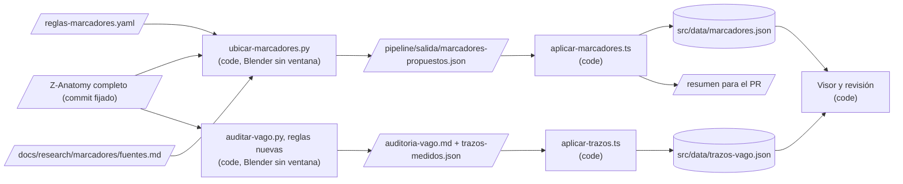

# Design: Propuestas para la sesión docente (marcadores y trazos del vago)

Status: approved  |  Date: 2026-10-14  |  Requirements: ./requirements.md
ADRs: docs/adr/0013-posiciones-propuestas-por-regla-anatomica.md
Aprobación: delegada por el editor el 2026-10-14 (ver requirements.md). Fuentes verificadas: docs/research/marcadores/fuentes.md (35 referencias, cada PMID comprobado contra Europe PMC el 2026-10-14).

Cada elemento cita los requisitos que sirve.

## Overview
Un script del pipeline abre el modelo completo de Z-Anatomy (commit fijado) en Blender sin ventana y aplica a cada marcador la regla escrita en `pipeline/reglas-marcadores.yaml`: operaciones geométricas sobre mallas con nombre (punto más alto, polo, superficie a cierta altura, punto sobre la curva del vago a cierta distancia del foramen yugular), sin coordenadas a mano (R1.1, R1.2). Cada regla nombra su fuente, y si la fuente no está registrada en `docs/research/marcadores/fuentes.md` el marcador queda sin ubicar (R2.1, R2.2). Otro script escribe el resultado en `src/data/marcadores.json` como `aproximada`, una posición por lado cuando la estructura es par, con el método y la cita en `fuente_ubicacion` (R1.5, R1.6, R2.3). La auditoría del vago gana reglas para raicillas y ramos abdominales y escribe evidencia, confianza y fuente por trazo en `src/data/trazos-vago.json` (R4). La app muestra esa evidencia al docente y le deja confirmar con un toque (R5). Todo cambio de datos llega en un PR de nivel C con un resumen antes y después (R6).

## Architecture


| Componente | Tipo | Responsabilidad | Ubicación | Sirve |
|---|---|---|---|---|
| Reglas | data | Una regla por marcador: operación, mallas, lado, clave de fuente, texto del método (es, en) | `pipeline/reglas-marcadores.yaml` (nuevo) | R1.2, R1.5, R2.1, R2.4 |
| Fuentes | doc | Tabla verificada por marcador y por regla de trazos, bibliografía con PMID/DOI | `docs/research/marcadores/fuentes.md` (nuevo, viene de la investigación del spec) | R2.1, R4.5 |
| Ubicador | code | Lee reglas y modelo, calcula puntos glTF, comprueba distancia a superficie (5 mm), falla con nombre si falta una malla o una fuente | `pipeline/ubicar-marcadores.py` (nuevo), reusa `pipeline/comun.py` | R1.1, R1.3, R1.4, R1.7, R2.2 |
| Pruebas del ubicador | code | Modelo sintético pequeño con mallas con nombre; cada operación y cada falla | `pipeline/pruebas/probar_ubicar.py`, `pipeline/pruebas/modelo_sintetico_marcadores.py` (nuevos) | R1.2, R1.3, R1.5, R2.2 |
| Aplicador de marcadores | code | Escribe `posicion`, `estado: aproximada` y `fuente_ubicacion` (y `ancla` si la propuesta la trae) sin tocar nada más; produce el resumen antes y después | `scripts/aplicar-marcadores.ts`, `scripts/lib/marcadores.ts` (nuevos) | R1.6, R2.3, R6.1, R6.2 |
| Esquema de marcador | code | `posicion` admite un punto o `{ l, r }` | `src/data/tipos.ts` | R1.5, R3.3 |
| Visor | code | Dibuja un punto por lado y desplaza el marcador con su ancla al separar | `src/components/Visor.tsx` | R3.1, R3.2, R3.3 |
| Auditoría con reglas nuevas | code | Raicilla (detrás de `Olive`, a la altura del bulbo), faríngeo frente a laríngeo superior, abdominales por destino (`Liver`, cara anterior o posterior de `Stomach`, aorta bajo el hiato), confianza y evidencia por trazo | `pipeline/auditar-vago.py`, `docs/research/vago/auditoria-vago.md`, `pipeline/salida/trazos-medidos.json` | R4.1 a R4.5 |
| Aplicador de trazos | code | Escribe `evidencia`, `confianza`, `fuente` y `propuesta` en cada trazo | `scripts/aplicar-trazos.ts` (nuevo) | R4.1 a R4.5, R6.2 |
| Revisión de trazos y marcadores | code | Muestra propuesta, confianza, evidencia y fuente; "Correcto" para la posición de un marcador | `src/components/RevisionTrazo.tsx`, `src/components/Ficha.tsx`, `src/i18n/*.json` | R5.1, R5.2, R5.3 |

## Workflow vs agent
Workflow: reglas fijas y deterministas sobre un modelo fijado; no hay IA (ADR 0002). (R1.7)

## Reglas por grupo (resumen; el detalle con cita está en fuentes.md)
- **Foramen yugular y ganglios:** el punto del foramen es el punto de la curva del vago más cercano al extremo superior de `Internal jugular vein` de cada lado (la vena empieza en el foramen). Ganglio superior en ese punto; ganglio inferior sobre la curva, 1 a 1,5 cm por debajo. Ramo auricular en su origen, el ganglio superior (no hay malla de oído). (R1.1, R1.5)
- **Ramos del cuello:** faríngeo y laríngeo superior en la curva del vago a la distancia mediana desde el foramen que da Bahadir 2026 (2,6 cm y 3,8 cm), desplazados hacia su destino (`Laryngopharynx`, `Thyroid cartilage`) hasta la superficie más cercana del destino si queda a menos de 5 mm de la curva, o en la curva si no. Cardíacos cervicales superiores entre la prominencia laríngea y la clavícula, por encima del origen del recurrente. (R1.1)
- **Recurrente y cardíacos cervicales inferiores:** asa del recurrente bajo `Right subclavian artery` (derecho) y bajo `Aortic arch` lateral a `Node of ligamentum arteriosum` (izquierdo); un punto por lado. Cardíacos inferiores junto a esa asa. (R1.1, R1.5)
- **Tórax:** cardíacos torácicos sobre la curva por debajo del recurrente; bronquiales y plexo pulmonar en la cara posterior de `Right/Left main bronchus` cerca del hilio (bronquiales queda con la nota de que la fuente habla de ramos pulmonares); plexo esofágico en la superficie de `Oesophagus` entre los bronquios y `Diaphragm`. (R1.1, R2.4)
- **Abdomen:** tronco anterior en la cara anterior de `Oesophagus` a la altura de `Diaphragm`, tronco posterior en la cara posterior; gástricos sobre la curvatura menor de `Stomach` (cara anterior o posterior); hepáticos entre la curvatura menor y `Liver`; celíacos hacia la cara anterior de `Thoracic aorta` justo bajo el hiato (regla aproximada, dicha en el texto). (R1.1, R2.3)
- **Tronco encefálico:** locus coeruleus en `Pons`, mitad rostral de `Fourth ventricle`, 1 a 2 mm ventral al piso junto al borde lateral, un punto por lado; rafe del bulbo en el plano medio entre `Medulla oblongata.l` y `.r` a la altura del centro de `Olive`; área postrema en el punto más caudal de `Fourth ventricle` (óbex), cara dorsal, línea media; periacueductal en el centro de `Aqueduct of midbrain` (Truong 2020). (R1.1, R1.5)
- **Tálamo y estriado:** núcleos anteriores en el polo anterosuperior de cada `Thalamus` (tercio anterior, mitad dorsal); accumbens debajo de la unión de `Caudate nucleus` y `Putamen`, entre el extremo rostral y el extremo posterior de `Anterior commissure`, un punto por lado (Birbilis 2021). (R1.1, R1.5)
- **Wernicke:** punto en el tercio posterior de `Superior temporal gyrus (Lateral part).l` junto a `Temporal plane.l`, definición clásica; `fuente_ubicacion` dice que la definición varía y cita Binder 2015, Matchin 2022 y Tremblay y Dick 2016. (R1.1, R2.4)

## Data model / schema impact
- `src/data/tipos.ts`, `Marcador.posicion`: `Vec3 | { l?: Vec3; r?: Vec3 } | null`. Lo actual (`Vec3 | null`) sigue siendo válido; sin migración. (R1.5, R3.3)
- `src/data/marcadores.json`: `posicion`, `estado` (`aproximada`) y `fuente_ubicacion` de los marcadores que el script ubica; `ancla` se conserva y se agrega donde la regla tiene una pieza principal (para seguir la fragmentación, R3.1). Nombres, padres y fichas no cambian. (R1.6, R6.2)
- `src/data/trazos-vago.json`: cada trazo gana `evidencia: { es, en }` y `confianza: 'alta' | 'media' | 'baja' | null`; `fuente` pasa a ser la de su regla; `propuesta` se llena solo cuando la regla distingue. (R4.1 a R4.5)
- `tests/datos.test.ts` y `tests/trazos.test.ts` se actualizan donde fijaban lo de hoy (Wernicke con `posicion: null`; exactamente 4 propuestas). (R1.6, R4.2)

## Interfaces and contracts
```yaml
# pipeline/reglas-marcadores.yaml (R1.2, R2.1)
marcadores:
  m-area-postrema:
    lado: medio          # medio | ambos | l | r
    operacion: plano_medio   # extremo | centro | polo | en_curva | superficie | plano_medio | entre
    mallas: [Medulla oblongata.l, Medulla oblongata.r]
    altura: { operacion: extremo, malla: Fourth ventricle, hacia: inferior }   # punto más caudal (óbex)
    profundidad: dorsal
    ancla: medulla-oblongata
    fuentes: [LaraGarcia2025, Agostinelli2023]
    metodo: { es: "En la línea media, a la altura del punto más caudal del cuarto ventrículo (el óbex)...", en: "On the midline, at the height of the most caudal point of the fourth ventricle (the obex)..." }
```
```ts
// scripts/lib/marcadores.ts (R1.6, R2.3, R6.2)
aplicarPropuestas(marcadores: Marcador[], propuestas: Propuesta[]): { marcadores: Marcador[]; resumen: string };
// Propuesta: { id, posicion: Vec3 | { l, r } | null, estado: 'aproximada' | 'sin_ubicar', motivo?, metodo: {es,en}, cita: {es,en}, ancla?, desacuerdo?: {es,en} }
```

## Error handling
| Falla | Alcance | Respuesta | Sirve |
|---|---|---|---|
| Malla nombrada no existe | fatal | Detiene, nombra marcador y malla, no escribe nada | R1.3 |
| Regla sin fuente registrada | por marcador | `sin_ubicar` con motivo en el resumen | R2.2 |
| Punto a más de 5 mm de toda malla de su regla | fatal | Detiene con el marcador y la distancia | R1.4 |
| Modelo con otro commit o hash | fatal | `descargar.py` ya verifica SHA-256 | R1.7 |
| Aplicador con un `id` desconocido | fatal | Detiene sin escribir | R6.2 |

- Idempotencia: el ubicador redondea a 5 decimales y ordena claves; dos corridas dan el mismo archivo (R1.7).

## Security considerations
- Sin entrada de usuarios, red solo para bajar el modelo y Blender (ya fijados por hash). Sin datos personales.
- Dependencia del pipeline: `bpy` 5.2.2 ya está en `pipeline/requirements.txt` (sin dependencias nuevas de la app).
- Revisión de seguridad: no aplica.

## Testing strategy
| Nivel | Qué | Cubre |
|---|---|---|
| unit (Python) | `probar_ubicar.py` sobre el modelo sintético: cada operación, un punto por lado, malla que falta, regla sin fuente, `aproximada` siempre | R1.2, R1.3, R1.5, R1.6, R2.2 |
| unit (TS) | `aplicar-marcadores`: solo cambia posición, estado y fuente (y ancla si la propuesta la trae); método y cita en es y en; desacuerdo citado en Wernicke; claves de fuentes que existen en `fuentes.md`; `aplicar-trazos`: evidencia, confianza, propuesta solo cuando distingue, raicilla como `no_es_ramo` | R2.1, R2.3, R2.4, R4.1 a R4.5, R6.2 |
| integration | Corrida real sobre Z-Anatomy en la nube (Blender por pip, modelo por git): 26 marcadores con posición o motivo, 5 mm, dos corridas idénticas | R1.1, R1.4, R1.7 |
| e2e | Marcador sigue a su ancla al separar y vuelve exacto al armar; un punto por lado; trazo muestra propuesta, confianza, evidencia y fuente; ficha muestra método y fuente; "Correcto" con un toque | R3.1 a R3.3, R5.1 a R5.3 |
| manual | El editor revisa el PR de datos con el resumen antes y después | R6.1 |

## Risk and cost
| Item | Por qué es nivel C | Costo mensual | Sirve |
|---|---|---|---|
| Cambios en `src/data/marcadores.json`, `src/data/trazos-vago.json` y `src/data/tipos.ts` | Ruta sensible (contenido anatómico y su esquema) | Ninguno | R1, R4, R6 |
| Correr Blender y bajar Z-Anatomy en la nube | Unos 400 MB de `bpy` más el modelo; ya se hizo para la auditoría | Ninguno | R1.1 |

Servicios pagos: ninguno.

## Alternatives considered
| Opción | Por qué se descartó |
|---|---|
| Registro MNI de coordenadas publicadas | Ver ADR 0013 |
| Calcular en la app en tiempo de ejecución (como hoy el centro de la pieza) | Las piezas vecinas que usan las reglas del vago (vena yugular, bronquios, hígado) no están en el GLB publicado |
| Medir sobre el GLB publicado sin Blender | Mismo problema: faltan las mallas de referencia del cuello, el tórax y el abdomen |
| Región resaltada para Wernicke | Función nueva y definición discutida; queda diferida |

## Open questions
- BLOCKING: ninguna.
- ADVISORY: el desplazamiento de unos milímetros del locus coeruleus y el centro del ganglio inferior son deducciones de la fuente (marcados "derivado" en fuentes.md); se dicen así en `fuente_ubicacion` (default: decirlo).
