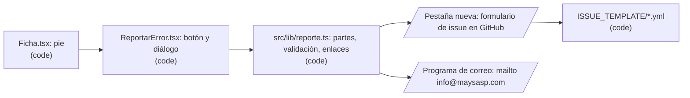

# Design: Reportar un error desde la ficha (F12)

Status: approved  |  Date: 2026-10-19  |  Requirements: ./requirements.md
ADRs: docs/adr/0016-reportes-por-github-y-correo.md

Every item below cites the requirement IDs it serves. Anything without an R reference does not
belong here.

## Overview
El pie de cada ficha suma el botón "Reportar un error", que no aparece en modo revisión (R1.1, R1.2). El botón abre un diálogo corto con tres campos: tipo, parte y descripción (R2). Con esos datos y lo que la ficha ya sabe (id, idioma activo, versión), una función pura arma dos enlaces: el formulario de issue de GitHub del tipo elegido, ya llenado, y un `mailto:` a info@maysasp.com (R3, R4, R7). Los dos son enlaces `<a>` que el navegador abre. La app no hace ninguna petición, no guarda nada y descarta el borrador al cerrar (R5). Cuatro formularios de issue en `.github/ISSUE_TEMPLATE/` reciben esos campos y etiquetan cada reporte (R6).

## Architecture


| Node / component | Kind | Responsibility | Location | Serves |
|---|---|---|---|---|
| Configuración | code | Constantes `URL_ISSUES` (`https://github.com/ragarciaga/3d_brain/issues/new`), `CORREO_REPORTES` (`info@maysasp.com`), `PLANTILLA` por tipo, `MAX_DESCRIPCION = 1500`, `MAX_URL = 8000` | src/config/reporte.ts (nuevo) | R3.1, R4.1, R2.3, R3.3 |
| Lógica del reporte | code | `partesDeFicha`, `descripcionValida`, `enlaceGithub`, `enlaceCorreo`, `cabeEnGithub`; funciones puras, sin acceso a `window` | src/lib/reporte.ts (nuevo) | R2.2, R2.3, R3.1 a R3.4, R4.1, R4.2, R7.1 |
| Botón y diálogo | code | Estado local del formulario, foco, Escape, aviso de privacidad, dos `<a>` de envío | src/components/ReportarError.tsx (nuevo) | R1.3, R1.4, R2.1, R2.4, R2.5, R4.3, R5.1, R5.2 |
| Pie de la ficha | code | Monta el botón si no hay revisor, con `id`, `idioma`, `version` y nombre de la estructura | src/components/Ficha.tsx | R1.1, R1.2 |
| Escape | code | Nueva entrada `cerrar-reporte` en `accionEscape`, primera después de la confirmación de salida | src/lib/teclado.ts | R1.3 |
| Textos | code | Sección `reporte` en es y en; línea nueva en `privacidad` | src/i18n/es.json, src/i18n/en.json, src/components/Privacidad.tsx | R8.1, R8.2 |
| Plantillas | code | Cuatro formularios YAML con los mismos ids de campo y su etiqueta | .github/ISSUE_TEMPLATE/contenido.yml, traduccion.yml, enlace-roto.yml, pieza-mal-ubicada.yml | R6.1, R6.2, R8.3 |

## Workflow vs agent
Workflow, porque el camino se conoce entero y no hay ningún modelo de lenguaje. (R1 a R8)

## UI
- **Pie de la ficha** (con ficha o sin ficha): enlace-botón "Reportar un error", pequeño, después de "Fuentes" y de la versión. Visible siempre, no dentro del `<details>` de fuentes. (R1.1)
- **Diálogo** `role="dialog"`, `aria-modal`, `aria-labelledby` al título "Reportar un error en <nombre>". Sigue el patrón de `DialogoAutorizacion` (`.aviso-modal` y `.aviso-caja`), con `max-height` y desplazamiento interno para 390 x 844 y 390 x 568. (R1.3, R1.4)
  - Tipo: cuatro radios con su descripción corta. Ninguno marcado al abrir. (R2.1)
  - Parte: `<select>` con "General" por omisión y las partes de esa ficha. (R2.2)
  - Descripción: `<textarea maxLength=1500>` con contador "n / 1500". (R2.3)
  - Aviso: "El reporte por GitHub queda público. No escribas datos personales." más el enlace a Privacidad. (R2.5)
  - Acciones: "Abrir en GitHub" y "Enviar por correo" son `<a>`. Mientras falte el tipo o la descripción quedan como botones desactivados (`aria-disabled`, sin `href`) y debajo se dice qué falta. (R2.4) Si el enlace de GitHub pasaría de 8000 caracteres, solo "Abrir en GitHub" se desactiva, con su motivo. (R3.4)
  - Debajo del correo, la dirección como texto: "o escribe a info@maysasp.com". (R4.3)
  - "Cerrar" devuelve el foco al botón del pie. Escape hace lo mismo. Al cerrar, el estado del formulario se pierde porque vive en el componente. (R1.3, R5.2)
- Estados: vacío (botones desactivados con el motivo), listo (dos enlaces activos), demasiado largo para GitHub (solo el correo activo). No hay estados de carga ni de error de red, porque la app no hace peticiones. (R2.4, R3.4, R5.1)

## Data model / schema impact
- Ningún archivo de datos cambia. `src/data/**` no se toca. (R5.1, R7.1)
- No se escribe nada en IndexedDB, localStorage, sessionStorage ni cookies. (R5.1)
- Plantillas nuevas en `.github/ISSUE_TEMPLATE/`, sin `config.yml`: los issues en blanco siguen permitidos para el harness. (R6.1)
- Etiquetas nuevas en GitHub: `reporte:contenido`, `reporte:traduccion`, `reporte:enlace-roto` y `reporte:pieza`, que crea el editor. (R6.3)

## Interfaces and contracts
```ts
// src/config/reporte.ts
export const URL_ISSUES = 'https://github.com/ragarciaga/3d_brain/issues/new';
export const CORREO_REPORTES = 'info@maysasp.com';
export const TIPOS = ['contenido', 'traduccion', 'enlace-roto', 'pieza'] as const;
export type TipoReporte = (typeof TIPOS)[number];
export const PLANTILLA: Record<TipoReporte, string> = {
  contenido: 'contenido.yml', traduccion: 'traduccion.yml',
  'enlace-roto': 'enlace-roto.yml', pieza: 'pieza-mal-ubicada.yml',
};
export const MAX_DESCRIPCION = 1500;
export const MAX_URL = 8000;

// src/lib/reporte.ts
export interface Reporte {
  tipo: TipoReporte;
  estructura: string;     // id de src/data, nunca un dato de la URL
  nombre: string;         // nombre visible en el idioma activo, solo para el título
  idioma: Idioma;
  version: string;        // Ficha.version o 'sin-ficha'
  parte: string;          // vocabulario de F24 (camposDeFicha) + 'recursos' + 'general'
  descripcion: string;    // 1 a 1500 caracteres, sin espacios solos
}
export function partesDeFicha(id: string): string[];          // R2.2, R7.1
export function descripcionValida(texto: string): boolean;     // R2.3, R2.4
export function enlaceGithub(r: Reporte, t: TFunction): string; // R3.1 a R3.3
export function cabeEnGithub(r: Reporte, t: TFunction): boolean; // R3.4
export function enlaceCorreo(r: Reporte, t: TFunction): string;  // R4.1, R4.2
```

| Función | Entrada | Salida | Errores | Serves |
|---|---|---|---|---|
| `partesDeFicha(id)` | id de estructura | `['general', ...campos únicos de camposDeFicha sin idioma, sin duda.N, posicion ni trazo:*, 'recursos' si la ficha tiene recursos]`; sin ficha: `['general', 'nombre']` | ninguno | R2.2, R7.1 |
| `enlaceGithub(r, t)` | Reporte | `URL_ISSUES + '?' + URLSearchParams({template, title, estructura, idioma, version, parte, descripcion})`. Título: `[<t(reporte.tipo.X)>] <nombre> (<id>)` | lanza si `tipo` no es de `TIPOS` | R3.1 a R3.3 |
| `cabeEnGithub(r, t)` | Reporte | `enlaceGithub(r, t).length <= MAX_URL` | ninguno | R3.3, R3.4 |
| `enlaceCorreo(r, t)` | Reporte | `mailto:info@maysasp.com?subject=...&body=...` con `encodeURIComponent` en los dos (no `URLSearchParams`, que pone `+` en vez de `%20`) | lanza si `tipo` no es de `TIPOS` | R4.1, R4.2 |

Contrato con las plantillas: cada `.yml` tiene `labels: [reporte:<tipo>]` y estos campos, con los mismos `id` que los parámetros: `estructura` (input), `idioma` (input), `version` (input), `parte` (input) y `descripcion` (textarea, `validations.required: true`). GitHub llena un formulario de issue desde la URL cuando el parámetro tiene el mismo nombre que el `id` del campo. (R6.1, R6.2)

## Error handling
| Failure | Scope (per item / fatal) | Response | Retry (backoff, max) | Serves |
|---|---|---|---|---|
| Falta el tipo o la descripción | per item | Enlaces desactivados y el motivo debajo | no aplica | R2.4 |
| Enlace de GitHub de más de 8000 caracteres | per item | Solo GitHub desactivado; el correo sigue | no aplica | R3.4 |
| El visitante no tiene programa de correo | per item | Ve la dirección como texto y la puede copiar | no aplica | R4.3 |
| GitHub pide iniciar sesión | per item | Lo resuelve GitHub en su pestaña; la app no cambia | no aplica | R3.1 |

- Idempotencia: cada pulsación abre una pestaña o un correo nuevo, y la app no lleva cuenta de nada. Un reporte duplicado se cierra en GitHub. (R5.1)
- Concurrencia: no aplica.
- Limpieza: el borrador vive solo en el estado del componente y se pierde al cerrar. (R5.2)

## Security considerations
- **El código del revisor nunca llega al reporte.** En modo revisión el botón no se monta (R1.2). Además, `enlaceGithub` y `enlaceCorreo` reciben solo el `Reporte`, armado desde props y `src/data`, y no leen `window.location`, `document.referrer` ni el store del revisor. Una prueba arma el reporte con `location` falso que trae `?r=` y comprueba que ninguno de los dos enlaces contiene el código ni `r=`. (R3.2, R4.2)
- Referrer: los enlaces llevan `rel="noopener noreferrer"` y la meta `strict-origin` ya está en `index.html`. GitHub no recibe la URL de la app. (R3.1)
- Entrada: la descripción es texto libre que solo pasa por `encodeURIComponent` o `URLSearchParams`. Nunca se inserta como HTML en la app. En GitHub se muestra como texto del formulario, y GitHub lo escapa. (R3.3)
- Datos personales: la app no recibe nada. GitHub muestra el usuario de quien abre el issue, y el correo llega con la dirección de quien escribe. Las dos cosas pasan fuera de la app, y el aviso (R2.5) y la página de Privacidad (R8.2) lo dicen. Decisión en el ADR 0016. (R5.1, R8.2)
- Hosts nuevos: `github.com/ragarciaga/3d_brain/issues/new` (solo como enlace que el visitante abre, sin fetch) y `mailto:`. El ADR 0015 no cambia: el beacon ya no carga en modo revisión, que es donde el botón no se ve.
- Dependencias nuevas: ninguna.
- Revisión de seguridad: sí, en la tarea del componente y en la de los enlaces (entrada externa y datos de quien reporta).

## Testing strategy
| Level | What | Covers |
|---|---|---|
| unit | `tests/reporte.test.ts`: `partesDeFicha` (con ficha, sin ficha, vocabulario igual a F24); `descripcionValida` (vacía, solo espacios, 1500, 1501); `enlaceGithub` (plantilla por tipo, título, cada parámetro, ida y vuelta de `#&\n"ñ`, sin `r=` con `location` falso, 1500 caracteres ASCII de 8000 o menos); `cabeEnGithub` (falso con 1500 emojis); `enlaceCorreo` (destinatario, asunto, cuerpo, `%20`, sin `r=`) | R2.2, R2.3, R3.1 a R3.4, R4.1, R4.2, R7.1 |
| unit | `tests/plantillas-issue.test.ts`: lee los cuatro `.yml` como texto y comprueba ids, `labels`, `required` y textos en es y en; compara con `PLANTILLA` y con los parámetros de `enlaceGithub` | R6.1, R6.2, R8.3 |
| unit | `tests/teclado.test.ts`: `cerrar-reporte` y su orden | R1.3 |
| unit | `tests/i18n.test.ts` y `check:i18n`: claves `reporte.*` y la línea de Privacidad en es y en | R8.1, R8.2 |
| e2e | `e2e/reportar-error.spec.ts`. Feliz: abrir el diálogo desde una ficha, elegir tipo y parte, escribir, leer el `href` de los dos enlaces y comprobar el `target` y el `rel`. Fallas: (a) sin tipo o sin texto los enlaces quedan desactivados con el motivo; (b) en modo revisión el botón no existe. Además: Escape devuelve el foco; en 390 x 568 se ve el último botón; ninguna petición propia ni escritura de almacenamiento mientras el diálogo está abierto y al enviar; al reabrir el formulario está vacío; entrada sin ficha | R1.1 a R1.4, R2.1, R2.4, R2.5, R4.3, R5.1, R5.2 |
| manual | Crear las cuatro etiquetas en GitHub y abrir un reporte de prueba desde el sitio publicado | R6.3 |

## Risk and cost
| Item | Why tier C | Cost estimate (monthly) | Serves |
|---|---|---|---|
| `.github/ISSUE_TEMPLATE/*.yml` | `.github/` es ruta del harness y de CI | none | R6.1 |
| Línea nueva en la página de Privacidad | texto legal de tratamiento de datos (Ley 1581) | none | R8.2 |
| SPEC.md F12 | ruta sensible; va en este mismo PR del spec | none | R1.2, R4.1 |
| ADR 0016 | decisión de arquitectura | none | R3, R4, R5 |

Paid services this feature needs: none.

## Alternatives considered
| Option | Why rejected |
|---|---|
| Recibir el reporte en el Apps Script del canal (ADR 0012) | Abriría al público un endpoint que hoy solo aceptan revisores del padrón, y la app guardaría datos de quien reporta en la hoja del editor. AGENTS.md lo prohíbe fuera de F24 |
| Un formulario de Google para el público | Guarda datos en la cuenta del editor, suma un proveedor más a Privacidad y no clasifica los reportes en GitHub |
| Issue en blanco con título y cuerpo prellenados, sin plantillas | El editor tendría que etiquetar a mano y el formato no quedaría fijo (lo descartaste en la decisión 4) |
| `window.open` en vez de `<a>` | Lo pueden bloquear los navegadores y no deja ver el destino. Además el repo usa `<a target="_blank" rel="noopener noreferrer">` en todos sus enlaces salientes |

## Open questions
- BLOCKING: ninguna. R3.3 se ajustó y R3.4 se agregó con la aprobación del diseño (2026-10-19): con mucho texto no ASCII el enlace pasaría de 8000 caracteres, y entonces se desactiva GitHub y queda el correo.
- ADVISORY: algunos programas de correo cortan el cuerpo de un `mailto:` largo (más de unos 2000 caracteres). Default: no cortarlo en la app. Si el programa lo corta, el visitante ve el texto incompleto antes de enviar.
- ADVISORY: la parte "recursos" es nueva y no está en F24. Default: sí, porque es donde están casi todos los enlaces rotos.
